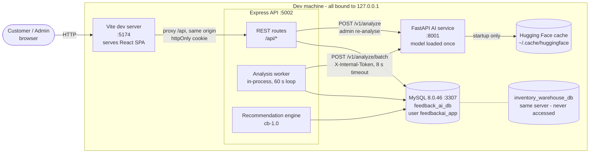
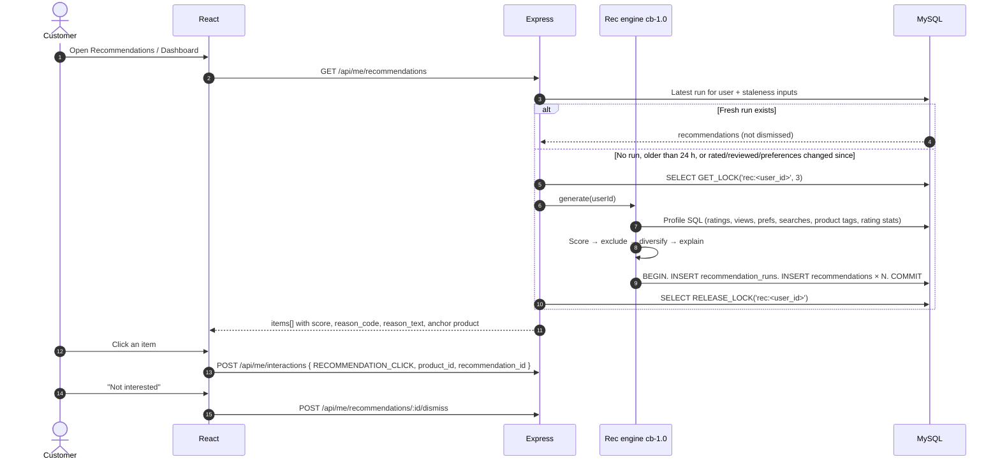
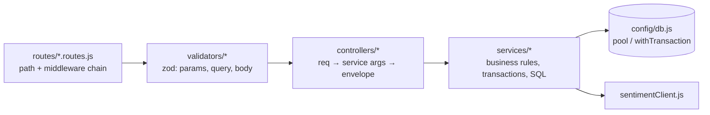
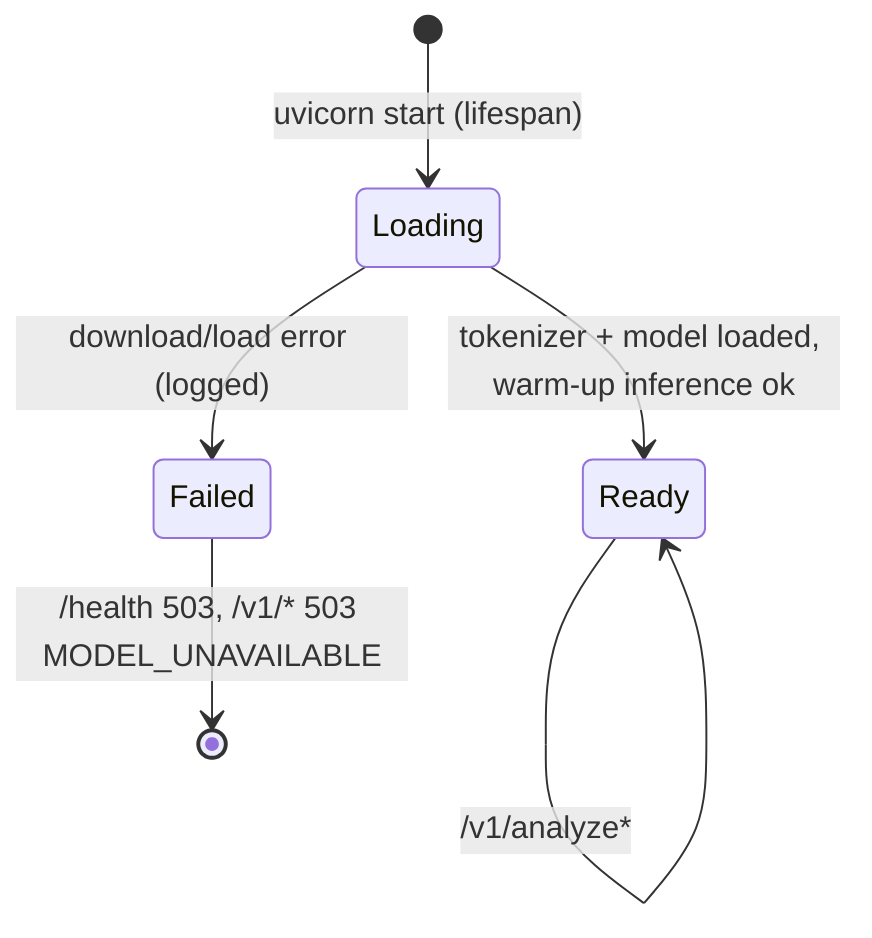

# 02 — System Architecture

Status: **proposed, awaiting approval**. Binding inputs: [00_DECISIONS.md](00_DECISIONS.md). The schema details are in [03_DATABASE_DESIGN.md](03_DATABASE_DESIGN.md).

FeedbackAI has three runtime services and one database. Each owns exactly one job:

| Service | Owns | Does not own |
|---|---|---|
| React SPA (Vite) | Presentation, routing, form UX, charts | Business rules, scoring, analytics maths |
| Express API | Auth, validation, business rules, SQL, the recommendation engine, the analysis job queue, reports | NLP inference |
| FastAPI AI service | Sentiment inference and aspect extraction | Any database access (it is stateless) |
| MySQL `feedback_ai_db` | All persistent state, constraints, views, procedures, triggers | — |

---

## 1. System context and containers



| Container | Port | Process | Start command (target) |
|---|---|---|---|
| Frontend | 5174 | Vite | `npm run dev` in `frontend/` |
| Backend | 5002 | Node 26 | `npm run dev` in `backend/` |
| AI service | 8001 | uvicorn (Python 3.11/3.12 venv) | `uvicorn app.main:app --host 127.0.0.1 --port 8001` |
| Database | 3307 | Existing mysqld (InventoryOS datadir) | Already running. Option B (a separate mysqld on 3308) is decided at approval. |

These ports avoid every port already in use: 5000 (AirPlay), 5001 (InventoryOS API), 5173 and 8000 (other projects).

---

## 2. Request flows

### 2a. Review submission and asynchronous sentiment analysis

The review is committed **before** any AI call, so the AI service can never block or lose a submission.

```mermaid
sequenceDiagram
  autonumber
  actor C as Customer
  participant UI as React
  participant API as Express
  participant DB as MySQL
  participant W as Analysis worker
  participant AI as AI service
  C->>UI: Stars + title + review text
  UI->>UI: Client validation, button disabled while pending
  UI->>API: PUT /api/me/reviews/:productId
  API->>API: requireAuth → requireRole(CUSTOMER) → zod validate
  API->>DB: SET @app_actor_id = ?; CALL sp_submit_review(...)
  Note over DB: One transaction. Upsert rating (UNIQUE user_id, product_id)<br/>and feedback (UNIQUE rating_id).<br/>trg_ratings_before_* rejects inactive product or suspended user.<br/>trg_feedback_after_insert creates sentiment_analysis PENDING.<br/>trg_feedback_after_update resets it to PENDING if body changed.
  DB-->>API: feedback_id
  API-->>UI: 200/201 { feedback, analysis: { status: PENDING } }
  UI-->>C: "Review saved. Analysis pending."
  API-)W: nudge(feedback_id) via setImmediate
  W->>DB: Claim: UPDATE sentiment_analysis SET status='PROCESSING' WHERE analysis_id=? AND status IN ('PENDING','FAILED')
  alt affectedRows = 0
    W-->>W: Another worker owns it, skip
  else claimed
    W->>AI: POST /v1/analyze/batch (8 s timeout)
    alt Valid response (zod-checked)
      AI-->>W: label, scores, language, aspects[]
      W->>DB: BEGIN. UPDATE analysis to COMPLETED (or UNSUPPORTED).<br/>DELETE + INSERT aspect_sentiments. COMMIT
    else Timeout, connection refused, 5xx or invalid JSON
      W->>DB: UPDATE status='FAILED', attempt_count+1, last_error
      Note over W,DB: The 60 s loop retries PENDING/FAILED rows with attempt_count < 5,<br/>in batches of 20. PROCESSING rows untouched for over 5 minutes are reclaimed.
    end
  end
  C->>UI: Later, opens My Feedback
  UI->>API: GET /api/me/reviews
  API-->>UI: Sentiment status per review (PENDING / COMPLETED / FAILED / UNSUPPORTED)
```

Seed data goes through the same worker code path in batch mode (`backend/scripts/analyze-pending.js`). There is no separate "fake" analysis path.

### 2b. Recommendation generation



---

## 3. Folder structure (target)

```
FeedbackAI/
├── PROJECT_TODO.md                  Task tracker (phases 1–13)
├── README.md                        Setup, run order, demo accounts, troubleshooting
├── docs/
│   ├── 00_DECISIONS.md              Binding decisions (single source of truth)
│   ├── 01_TECHNICAL_ASSESSMENT.md   Audit: reuse / modify / retire / build
│   ├── 02_ARCHITECTURE.md           This document
│   ├── 03_DATABASE_DESIGN.md        ER diagram, schema, data dictionary, normalization
│   ├── 04_DBMS_OBJECTS_AND_QUERIES.md  Views, procedures, triggers, analytical SQL
│   ├── 05_SEED_DATA_STRATEGY.md     Seed corpus, realism rules, idempotency
│   ├── 06_RISKS_AND_BOTTLENECKS.md  Cause → impact → solution
│   ├── 07_IMPLEMENTATION_PLAN.md    Phases, gates, test plan
│   ├── api/API_REFERENCE.md         (Phase 13) endpoint reference generated from routes
│   └── demo/DEMO_SCRIPT.md          (Phase 13) live demonstration walkthrough
├── database/
│   ├── 00_create_database.sql       CREATE DATABASE feedback_ai_db + feedbackai_owner/app grants
│   ├── 01_schema.sql                17 tables, constraints, indexes (CREATE TABLE IF NOT EXISTS)
│   ├── 02_views.sql                 CREATE OR REPLACE VIEW v_*
│   ├── 03_procedures.sql            DROP PROCEDURE IF EXISTS + CREATE sp_*
│   ├── 04_triggers.sql              DROP TRIGGER IF EXISTS + CREATE trg_*
│   ├── queries/dbms_showcase.sql    The required analytical queries (joins, GROUP BY, HAVING, subqueries)
│   ├── tests/constraint_tests.sql   Statements that must fail (duplicate rating, bad stars, …)
│   └── seed/
│       ├── catalog.json             Categories, products, tags, aspects (hand-authored)
│       ├── corpus/*.json            Hand-written reviews per product type + intended sentiment/aspects
│       ├── generate.py              Deterministic assignment of users, products, dates (fixed RNG seed)
│       └── generated/demo-v1.json   Committed generator output, reviewed in git diffs
├── backend/
│   ├── package.json
│   ├── .env.example                 Placeholders only (no secrets)
│   ├── src/
│   │   ├── server.js                Starts HTTP server + analysis worker, graceful shutdown
│   │   ├── app.js                   Builds Express app (middleware + routers); imported by tests
│   │   ├── config/
│   │   │   ├── env.js               zod-validated environment; fail fast on missing secrets
│   │   │   └── db.js                mysql2/promise pool (feedbackai_app), withTransaction helper
│   │   ├── middleware/
│   │   │   ├── requireAuth.js      Reads JWT cookie → loads user (role, status) by PK
│   │   │   ├── requireRole.js       CUSTOMER / ADMIN gate
│   │   │   ├── validate.js          zod schema → 422 with field errors
│   │   │   ├── rateLimits.js        Login/register/review/refresh limiters
│   │   │   ├── requestId.js         Correlation id + concise access log
│   │   │   └── errorHandler.js      Maps AppError/MySQL errors → envelope; hides internals
│   │   ├── routes/                  auth, catalog, me, admin/*.routes.js (wiring only)
│   │   ├── controllers/             HTTP ↔ service translation; no SQL
│   │   ├── services/
│   │   │   ├── auth.service.js      bcrypt, JWT issue/verify
│   │   │   ├── catalog.service.js   Products, categories, search (FULLTEXT for terms of 3+ chars, parameterized LIKE prefix fallback for shorter)
│   │   │   ├── reviews.service.js   sp_submit_review, my reviews, moderation
│   │   │   ├── interactions.service.js  Logging + dedupe of views/searches/clicks
│   │   │   ├── analytics.service.js Admin KPIs, distributions, trends (views + parameterized SQL)
│   │   │   ├── sentimentClient.js   HTTP client for AI service (timeout, token, zod response check)
│   │   │   ├── analysisWorker.js    Claim → analyse → store; retry loop
│   │   │   ├── recommendations/
│   │   │   │   ├── profile.js       Feature SQL → user profile
│   │   │   │   ├── scoring.js       Pure functions: similarity, affinity, prior, diversity
│   │   │   │   ├── explain.js       reason_code / reason_text selection
│   │   │   │   └── engine.js        Orchestrates generate / staleness / storage
│   │   │   └── reports/
│   │   │       ├── definitions.js   One SQL builder per report_type
│   │   │       └── csv.js           Streaming CSV with formula-injection escaping
│   │   ├── validators/              zod schemas per route group
│   │   └── utils/                   apiResponse, AppError, pagination, asyncHandler, sortWhitelist
│   ├── scripts/
│   │   ├── migrate.js               Runs database/0*.sql in order as feedbackai_owner
│   │   ├── seed.js                  Idempotent upsert of demo-v1 in one transaction
│   │   └── analyze-pending.js       Batch-analyses PENDING/FAILED rows through the AI service
│   └── tests/                       node:test + supertest (API) and pure unit tests (scoring)
├── ai-service/
│   ├── requirements.txt             Pinned versions
│   ├── .env.example                 INTERNAL_TOKEN, MODEL_NAME, NEUTRAL_THRESHOLD
│   ├── app/
│   │   ├── main.py                  FastAPI app, lifespan (load once), routes, auth dependency
│   │   ├── config.py                Settings (pydantic-settings)
│   │   ├── model.py                 Tokenizer/model holder, batched predict(), label policy
│   │   ├── aspects.py               Clause splitter + lexicon matcher + clause classification
│   │   ├── language.py              langdetect wrapper (seeded, minimum length)
│   │   └── schemas.py               Request/response pydantic models
│   ├── lexicon/aspects.json         Versioned aspect lexicon (general + per category)
│   ├── scripts/evaluate.py          Accuracy / macro-F1 vs seed intended labels
│   └── tests/                       pytest: schemas, policy, aspects, error paths (model mocked)
└── frontend/
    ├── package.json, vite.config.js (port 5174, proxy /api → 127.0.0.1:5002)
    ├── tailwind.config.js, postcss.config.js
    └── src/
        ├── main.jsx                 Router + providers
        ├── App.jsx                  Route table (customer + admin trees)
        ├── styles/index.css         Tailwind layers + CSS custom-property tokens
        ├── lib/                     api.js (axios), useApiQuery.js, format.js, chartTheme.js, constants.js
        ├── context/                 AuthContext.jsx, ToastContext.jsx
        ├── components/
        │   ├── ui/                  Button, Field, Input, Textarea, Select, Checkbox, StarRating,
        │   │                        SentimentTag, StatusBadge, DataTable, Pagination, FilterBar,
        │   │                        Modal, ConfirmDialog, Toast, Skeleton, EmptyState, ErrorState, Tabs
        │   ├── layout/              CustomerLayout, AdminLayout, ProtectedRoute, PageHeader
        │   └── charts/              SentimentStackedBar, TrendLine, RatingHistogram, AspectBars, KpiStat
        └── pages/
            ├── customer/            Landing, Login, Register, Dashboard, Explore, Category,
            │                        ProductDetail, WriteReview, MyFeedback, Activity,
            │                        Recommendations, Profile
            └── admin/               Dashboard, Users, Products, Categories, Feedback,
                                     Sentiment, ProductPerformance, Reports
```

InventoryOS-only files (inventory, order, warehouse, transfer, movement, supplier and purchase-order controllers, plus `WarehousePortal`, `OrderModal`, `CustomerPortal`) are removed in Phase 4 after the `inventoryos-baseline` tag is created.

---

## 4. Backend layering



| Layer | Rule |
|---|---|
| Routes | Wiring only: `router.put('/reviews/:productId', requireAuth, requireRole('CUSTOMER'), reviewLimiter, validate(schema), asyncHandler(ctrl.upsert))` |
| Validators | Coerce and limit every input: ids are positive integers, `pageSize` ≤ 100, sort keys come from a whitelist, text is trimmed and length-checked |
| Controllers | No SQL. Take the user id from `req.user` and never from params or body. Return the envelope |
| Services | All SQL, always parameterized (`?`). Dynamic `ORDER BY` uses only whitelisted column maps. Multi-statement writes use `withTransaction(fn)`, which sets `@app_actor_id` inside the transaction and resets it to NULL in `finally` before releasing the connection |
| DB | One pool (`connectionLimit` 10, `namedPlaceholders` off, `dateStrings` on for stable JSON). Account `feedbackai_app` has no DDL rights |

**Middleware order** in `app.js`:

1. `helmet()`: security headers.
2. `cors({ origin: 'http://localhost:5174', credentials: true })`: only used when not going through the proxy.
3. `express.json({ limit: '64kb' })`.
4. `cookieParser()`.
5. `requestId` + access log. This logs method, path, status and duration only. It never logs bodies, cookies or query values on `/auth/*`.
6. `GET /api/health`: checks DB ping and AI `/health` and reports both.
7. `/api/auth` (`loginLimiter`, `registerLimiter`), then `/api` catalog (public), then `/api/me` (`requireAuth`, `requireRole('CUSTOMER')`), then `/api/admin` (`requireAuth`, `requireRole('ADMIN')`).
8. 404 handler: envelope with `code: NOT_FOUND`.
9. `errorHandler`:
   - zod errors → 422;
   - `ER_DUP_ENTRY` → 409;
   - `ER_ROW_IS_REFERENCED_2` → 409 with a "use archive instead" message;
   - `ER_NO_REFERENCED_ROW_2` → 422;
   - SIGNAL SQLSTATE `45000` (triggers and procedures) → 422 with the SIGNAL message;
   - anything else → 500 `INTERNAL_ERROR` with no internals.

Express 4 is kept. Every async handler is wrapped in `asyncHandler`, which fixes the unhandled-rejection pattern found in the audit.

---

## 5. REST API surface

Envelope: `{ success, data, meta? }` or `{ success:false, error:{ code, message, fields? } }`. Lists accept `page` (default 1) and `pageSize` (default 20, max 100) and return `meta: { page, pageSize, total }`.

### Auth and health

| Method | Path | Role | Purpose |
|---|---|---|---|
| POST | /api/auth/register | Public (rate-limited) | Create a CUSTOMER account with optional preferred `category_ids[]`, then set the cookie |
| POST | /api/auth/login | Public (rate-limited) | Verify bcrypt, reject SUSPENDED, set the JWT cookie, update `last_login_at` |
| POST | /api/auth/logout | Any | Clear the cookie |
| GET | /api/auth/me | Authenticated | Current user (id, name, email, role) |
| GET | /api/health | Public | `{ db: up/down, ai: up/down/model_loading }` with no secrets |

### Catalog (public; interactions are logged only when signed in)

| Method | Path | Role | Purpose |
|---|---|---|---|
| GET | /api/categories | Public | Categories with product counts (Landing, Explore filters) |
| GET | /api/categories/:slug | Public | Category header and stats (Category page) |
| GET | /api/products | Public | Explore. Filters: `category`, `q` (FULLTEXT, or LIKE prefix for terms under 3 chars), `minRating`, `minPrice`, `maxPrice`, `tags`. Sort: `top_rated`, `most_reviewed`, `newest`, `price_asc`, `price_desc`. Paginated |
| GET | /api/products/:slug | Public | Product detail with rating stats (`v_product_rating_stats`), star distribution and aspect summary |
| GET | /api/products/:slug/reviews | Public | Published reviews. Filters: `stars`, `sentiment`. Sort: `newest`, `highest`, `lowest`. Shows a "Demo data" flag when seeded |
| GET | /api/products/:slug/similar | Public | Up to 6 products by tag similarity in the same category (Product detail) |

### Customer (`/api/me`, role CUSTOMER)

| Method | Path | Purpose (page) |
|---|---|---|
| GET | /api/me/dashboard | Counts (reviews, ratings, views), latest 5 activity items, top 4 recommendations (Customer dashboard) |
| GET | /api/me/profile | Profile and preferred categories (Profile) |
| PATCH | /api/me/profile | Update `full_name` (Profile) |
| PATCH | /api/me/password | Change password. Requires the current password (Profile) |
| PUT | /api/me/preferences | Replace preferred categories (Profile, Register) |
| GET | /api/me/reviews/:productId | My existing rating and review for a product, to prefill (WriteReview) |
| PUT | /api/me/reviews/:productId | Upsert stars plus optional title and body through `sp_submit_review`. PUT is idempotent, so a double submit is safe (WriteReview) |
| DELETE | /api/me/reviews/:productId | Delete my rating and review after confirmation (MyFeedback) |
| GET | /api/me/reviews | My reviews with sentiment status and label, paginated, filterable by sentiment (MyFeedback) |
| GET | /api/me/activity | `v_user_activity`. Filters: `type`, `from`, `to`. Paginated (Activity) |
| POST | /api/me/interactions | Log PRODUCT_VIEW, CATEGORY_VIEW, SEARCH or RECOMMENDATION_CLICK. The server drops a duplicate view of the same product within 30 minutes (Explore, Category, ProductDetail) |
| GET | /api/me/recommendations | Latest run, regenerated if stale (Recommendations, Dashboard) |
| POST | /api/me/recommendations/refresh | Force regeneration, rate-limited to 6 per hour (Recommendations) |
| POST | /api/me/recommendations/:id/dismiss | Mark "not interested" by setting `dismissed_at` (Recommendations) |

### Admin (`/api/admin`, role ADMIN). Every write also inserts into `audit_log`.

| Method | Path | Purpose (page) |
|---|---|---|
| GET | /api/admin/dashboard | KPIs: users, products, reviews, average rating, sentiment percentages, top and bottom products, category satisfaction, volume trend, top complaints and praise. Filters: `from`, `to`, `category`, `product`, `sentiment` (Admin dashboard) |
| GET | /api/admin/users | Search, role and status filters, sort, paginated (Users) |
| GET | /api/admin/users/:id | Profile with review and activity counts (Users drawer) |
| PATCH | /api/admin/users/:id | Change `role` or `status`. The trigger blocks demoting the last admin (Users) |
| DELETE | /api/admin/users/:id | Hard delete. Requires `confirm: <email>` in the body. Cascades as documented (Users) |
| GET / POST | /api/admin/categories | List with product counts / create (Categories) |
| PATCH / DELETE | /api/admin/categories/:id | Edit / delete. Delete is RESTRICT, so it returns 409 when the category has products (Categories) |
| GET / POST | /api/admin/products | List with filters, including inactive / create (Products) |
| PATCH | /api/admin/products/:id | Edit fields, `is_active` (archive or restore) (Products) |
| DELETE | /api/admin/products/:id | Only for products with no history, otherwise 409 suggesting archive (Products) |
| GET / POST | /api/admin/tags | Tag vocabulary (Products form) |
| PUT | /api/admin/products/:id/tags | Replace a product's tags (Products form) |
| GET | /api/admin/feedback | All feedback. Filters: `status`, `sentiment`, `analysis_status`, `category`, `product`, `from`, `to`, `q`, `demo`. Paginated (Feedback) |
| PATCH | /api/admin/feedback/:id/status | Set PUBLISHED, HIDDEN or FLAGGED with a note. The trigger audits it (Feedback) |
| POST | /api/admin/feedback/:id/reanalyze | Reset to PENDING and nudge the worker (Feedback, Sentiment) |
| POST | /api/admin/sentiment/retry-failed | Requeue FAILED rows (Sentiment) |
| GET | /api/admin/analytics/sentiment | Distribution, by category, monthly trend, confidence histogram, pipeline status counts (Sentiment) |
| GET | /api/admin/analytics/aspects | Most praised and most complained-about aspects with evidence samples (Sentiment, Dashboard) |
| GET | /api/admin/analytics/products | `v_product_performance` with filters, sort and HAVING thresholds (`minReviews`, `minAvg`) (Product performance) |
| GET | /api/admin/analytics/products/:id | Drill-down: monthly ratings, aspect split, latest negative reviews (Product performance) |
| GET | /api/admin/analytics/ratings | Star distribution, average by category and month (Dashboard) |
| GET | /api/admin/reports | Report history (parameters, row_count, author, time) (Reports) |
| POST | /api/admin/reports | Generate with `report_type` and filters. Stores the parameter row and returns a preview (first 50 rows) (Reports) |
| GET | /api/admin/reports/:id/export.csv | Re-runs the stored parameters and streams CSV (Reports) |
| GET | /api/admin/system | DB/AI health, model name and version, PENDING/FAILED counts, worker last run (Sentiment, Dashboard footer) |

### Internal (AI service, Express only, `X-Internal-Token` required, 127.0.0.1 only)

| Method | Path | Purpose |
|---|---|---|
| GET | /health | `{ status, model_loaded, model_name, model_version }`. Returns 503 while the model is loading or has failed |
| POST | /v1/analyze | Single text. Used for admin re-analysis |
| POST | /v1/analyze/batch | Up to 32 items. Used by the worker and the seed analysis script |

---

## 6. AI sentiment service design

### Module responsibilities

| Module | Responsibility |
|---|---|
| `main.py` | App factory. `lifespan` loads the model once and stores it on `app.state`. Routes. `verify_token` dependency. Exception handlers that map to stable error codes |
| `model.py` | Holds tokenizer and model, calls `model.eval()`, runs `predict(texts) -> list[Scores]` under `torch.inference_mode()` with batching, truncation at 512 tokens and a `was_truncated` flag, and applies the label policy |
| `aspects.py` | `split_clauses()`, then `match_aspects(clause, category_slug)` against the lexicon, then classifies all matched clauses in **one** batched `predict` call and merges duplicates per aspect |
| `language.py` | `langdetect` with `DetectorFactory.seed = 0` for determinism. Texts shorter than 20 characters are treated as English (detection is unreliable there) |
| `schemas.py` | pydantic v2 request and response models with `extra='forbid'` |
| `config.py` | `MODEL_NAME`, `MODEL_REVISION`, `NEUTRAL_THRESHOLD=0.55`, `MAX_CHARS=4000`, `MAX_BATCH=32`, `INTERNAL_TOKEN`, `TORCH_THREADS` |

### Model lifecycle

The model loads exactly once per process, never per request.



- The model is pinned to a Hugging Face revision for reproducibility. After the first download (about 500 MB) it runs offline from the local cache.
- It is `cardiffnlp/twitter-roberta-base-sentiment-latest`, CPU only, with `torch.set_num_threads(TORCH_THREADS)` and a single uvicorn worker, so there is only one model copy in memory.

### Label policy (`policy-1`)

1. Softmax gives `scores = {positive, neutral, negative}` (summing to 1).
2. The label is the argmax. **If `max(scores) < 0.55`, the label is NEUTRAL.**
3. `model_version = "<revision-short>+policy-1"`, so any policy change is traceable in `sentiment_analysis.model_version`.
4. Confidence is not returned as a separate field. Express and the views derive it as the score of the stored label.

### Aspect pipeline: lexicon-based, not trained ABSA

This is **rule-based aspect extraction plus clause-level sentiment** using the same 3-class model. It is not a trained aspect-based sentiment model. It is explainable (each result carries its evidence clause) and deterministic. Its known limits are listed in 06_RISKS_AND_BOTTLENECKS.md: implicit aspects, sarcasm, negation crossing clause boundaries, and keywords outside the lexicon.

1. **Clause split:** sentence boundaries (`.`, `!`, `?`, newlines), then contrast markers (`but`, `though`, `however`, `although`, `except`, `yet`, `whereas`), keeping each marker with the clause that follows it.
2. **Match:** lower-cased, punctuation-normalised whole-word or phrase match against `lexicon/aspects.json`. The lexicon has `general` aspects (delivery, packaging, price/value, customer service, durability) plus per-category aspects (e.g. Electronics: battery life, sound quality, display, performance, build quality. Fashion: fit/size, comfort, material. Beauty: skin feel, fragrance. Books: writing/story. Sports: grip, comfort. Home Appliances: noise, ease of use). Aspect slugs are the same values as `aspects.slug` in MySQL.
3. **Classify:** all matched clauses for all items in a request are classified in one batched forward pass. The policy is the same as for the overall label.
4. **Merge:** if an aspect appears in more than one clause, keep the clause with the highest top score. Evidence is capped at 300 characters.
5. **Overall MIXED** is not produced here. It is derived in SQL (`v_feedback_details.is_mixed`) when an analysis has at least one POSITIVE and one NEGATIVE aspect.

### Schemas

```jsonc
// POST /v1/analyze  (batch: { "items": [ { "id": 17, "text": "...", "category_slug": "electronics" } ] })
// request
{ "text": "The headphones have excellent sound quality, but the battery drains too quickly.",
  "category_slug": "electronics" }

// 200 response
{ "status": "OK",                      // or "UNSUPPORTED_LANGUAGE" (label/scores/aspects null/empty)
  "label": "NEGATIVE",
  "scores": { "positive": 0.3121, "neutral": 0.1405, "negative": 0.5474 },
  "language": "en",
  "was_truncated": false,
  "aspects": [
    { "aspect": "sound-quality", "polarity": "POSITIVE", "score": 0.9712,
      "evidence": "The headphones have excellent sound quality" },
    { "aspect": "battery-life",  "polarity": "NEGATIVE", "score": 0.9338,
      "evidence": "but the battery drains too quickly" } ],
  "model_name": "cardiffnlp/twitter-roberta-base-sentiment-latest",
  "model_version": "<rev>+policy-1" }
// The values are illustrative. The Express sentimentClient validates this shape with zod and treats
// any deviation as an invalid response (stored as FAILED, last_error='INVALID_RESPONSE').
```

The batch response is `{ "results": [ { "id": 17, ...same fields... } ] }`. Per-item failures are returned as `{ "id": 17, "error": { "code": ... } }`, so one bad item never fails the whole batch.

### Error codes

| HTTP | `error.code` | Cause | Express worker action |
|---|---|---|---|
| 401 | `UNAUTHORIZED` | Missing or wrong `X-Internal-Token` | FAILED, logged as a configuration error |
| 413 | `TEXT_TOO_LONG` | Over 4000 characters (Express also blocks this) | FAILED (no retry) |
| 422 | `INVALID_INPUT` | Empty or whitespace text, batch over 32, bad schema | FAILED (no retry) |
| 503 | `MODEL_UNAVAILABLE` | Model still loading or failed to load | FAILED, retried later |
| 500 | `INFERENCE_ERROR` | Unexpected exception (message logged, not returned) | FAILED, retried later |
| — | Timeout (8 s) / ECONNREFUSED | Service down or slow | FAILED, retried later (attempt_count < 5) |

A 200 response with `status: "UNSUPPORTED_LANGUAGE"` is stored as `UNSUPPORTED` and never retried.

### Memory and latency expectations (to be measured in Phase 8)

| Metric | Expectation (RoBERTa-base, about 125M parameters, fp32, Apple Silicon CPU) |
|---|---|
| Resident memory | About 1.0–1.4 GB for one process (weights about 500 MB plus runtime) |
| Cold start | About 5–15 s from local cache. First run also downloads about 500 MB |
| Single short review | About 30–100 ms overall, plus one batched pass for aspect clauses |
| Batch of 32 reviews | About 1–3 s |
| Seed set (~200 reviews) | Under 1 minute end to end through `analyze-pending.js` |

---

## 7. Recommendation engine design (`cb-1.0`)

This is **content-based filtering** over product tags and categories, with a quality prior. It is not collaborative filtering and the UI and docs never claim it is.

### Inputs

| Signal | Source | Weighting |
|---|---|---|
| Ratings | `ratings` × `product_tags` | `stars − 3`, so 5★ = +2, 4★ = +1, 3★ = 0, 2★ = −1, 1★ = −2 per tag |
| Product views | `user_interactions` PRODUCT_VIEW (last 90 days) | 0.3 × 0.5^(age_hours / 336), a 14-day half-life |
| Preferred categories | `user_category_preferences` | Explicit affinity of +0.5 |
| Searches | `user_interactions` SEARCH (last 5 queries, 30 days) | FULLTEXT relevance |
| Product quality | `v_product_rating_stats.bayes_avg` | Bayesian average, C = 5 against the global mean |

### Feature SQL (sketch, parameterized)

```sql
-- Tag weights from ratings
SELECT pt.tag_id, SUM(r.stars - 3) AS w
FROM ratings r JOIN product_tags pt ON pt.product_id = r.product_id
WHERE r.user_id = ? GROUP BY pt.tag_id;

-- Tag weights from recent views (decayed)
SELECT pt.tag_id,
       SUM(0.3 * POW(0.5, TIMESTAMPDIFF(HOUR, ui.occurred_at, NOW()) / 336)) AS w
FROM user_interactions ui JOIN product_tags pt ON pt.product_id = ui.product_id
WHERE ui.user_id = ? AND ui.interaction_type = 'PRODUCT_VIEW'
  AND ui.occurred_at >= NOW() - INTERVAL 90 DAY
GROUP BY pt.tag_id;

-- Search relevance for the user's recent queries (one query string, joined by spaces)
SELECT p.product_id, MATCH(p.name, p.brand, p.description) AGAINST (? IN NATURAL LANGUAGE MODE) AS rel
FROM products p WHERE p.is_active = 1 HAVING rel > 0;

-- Candidates: active, not yet rated by this user
SELECT p.product_id, p.category_id, s.bayes_avg, s.rating_count
FROM products p JOIN v_product_rating_stats s ON s.product_id = p.product_id
WHERE p.is_active = 1
  AND NOT EXISTS (SELECT 1 FROM ratings r WHERE r.user_id = ? AND r.product_id = p.product_id);
```

Scoring runs in JavaScript (`scoring.js`). These are pure functions and are unit-tested. With 36 products (and up to a few thousand) the whole candidate set is scored in memory in milliseconds.

### Scoring

```
tag_similarity   = max(0, cosine(user_tag_vector, product_tag_vector))     ∈ [0,1]
category_affinity= min(1, 0.5·[preferred] + 0.5·(positive_signals_in_cat / max_over_cats))
search_match     = rel / max(rel)  over candidates                          ∈ [0,1]
quality_prior    = (bayes_avg − 1) / 4                                       ∈ [0,1]

score = 0.40·tag_similarity + 0.25·category_affinity + 0.15·search_match + 0.20·quality_prior
```

### Exclusions, anti-repetition and diversity

1. **Excluded:** products already rated, `is_active = 0`, dismissed in the last 30 days.
2. **Anti-repetition:** a product shown in the user's last 3 runs with no RECOMMENDATION_CLICK is excluded. Because the catalogue is small, this rule is **relaxed** (the exclusion is dropped, lowest-score first) whenever fewer than 10 candidates would remain. Without that, a user could run out of products entirely.
3. **Diversity:** greedy selection in score order, with at most 3 products per category in the top 10.
4. **Output:** the top 10 are stored, with `rank_position` 1–10.

### Explanations

Each item's reason is the term with the largest weighted contribution:

| Strongest term | reason_code | reason_text example | anchor_product_id |
|---|---|---|---|
| tag_similarity, anchor is a 4–5★ rated product | SIMILAR_TO_RATED | "Because you rated Sony WH-1000XM5 5★: shares noise-cancelling, wireless" | That product |
| tag_similarity, anchor is a recently viewed product | SIMILAR_TO_VIEWED | "Similar to Fitbit Charge 6, which you viewed recently" | That product |
| category_affinity | PREFERRED_CATEGORY | "Matches your interest in Sports and Fitness" | NULL |
| search_match | SEARCH_MATCH | "Matches your search 'running shoes'" | NULL |
| quality_prior (personalised run) or cold-start top rated | TOP_RATED_FALLBACK | "Rated 4.6★ across 12 reviews" | NULL |
| cold-start popularity | POPULAR_FALLBACK | "Popular this quarter: 9 reviews in the last 90 days" | NULL |

The anchor is the rated (≥4★) or viewed product with the highest tag Jaccard overlap with the candidate.

### Cold start

| User state | Strategy | Method |
|---|---|---|
| No ratings or views, has preferred categories | COLD_START | Top Bayesian-rated products in the preferred categories (≥3 reviews), then top rated overall |
| Nothing at all | COLD_START | Interleave POPULAR_FALLBACK (most reviews in the last 90 days) and TOP_RATED_FALLBACK (bayes_avg, ≥3 reviews), respecting the diversity cap |
| Any rating or view | PERSONALIZED | Full formula |

### Storage and staleness

- Each generation writes one `recommendation_runs` row (`algorithm_version='cb-1.0'`, `strategy`) and N `recommendations` rows in a single transaction. The history is kept, which is what makes anti-repetition and click-through analysis possible.
- **Stale** when any of these hold:
  - no run exists;
  - the latest `generated_at` is more than 24 hours ago;
  - `MAX(ratings.updated_at)` for the user is later than `generated_at`;
  - the user's latest `user_category_preferences.created_at` is later than `generated_at`;
  - an explicit refresh was requested.
- Concurrent requests for the same user are serialised with `GET_LOCK('rec:<user_id>', 3)`. A request that loses the lock re-reads the run the winner wrote.

---

## 8. Frontend architecture

### Route map (React Router v6). Customer and admin use separate layouts and navigation.

| Path | Page | Access | Layout |
|---|---|---|---|
| `/` | Landing | Public | CustomerLayout (public header) |
| `/login`, `/register` | Login, Register | Guest only (signed-in users are redirected) | Minimal auth layout |
| `/explore` | Explore products (search, filters in URL params) | Public | CustomerLayout |
| `/categories/:slug` | Category page | Public | CustomerLayout |
| `/products/:slug` | Product details + reviews + similar products | Public | CustomerLayout |
| `/products/:slug/review` | Feedback submission (create or edit) | CUSTOMER | CustomerLayout |
| `/account` | Customer dashboard | CUSTOMER | CustomerLayout + account sub-nav |
| `/account/feedback` | My feedback | CUSTOMER | 〃 |
| `/account/activity` | Activity history | CUSTOMER | 〃 |
| `/account/recommendations` | Recommendations | CUSTOMER | 〃 |
| `/account/profile` | Profile and preferences | CUSTOMER | 〃 |
| `/admin` | Admin dashboard | ADMIN | AdminLayout (sidebar) |
| `/admin/users` | User management | ADMIN | 〃 |
| `/admin/products` | Product management | ADMIN | 〃 |
| `/admin/categories` | Category management | ADMIN | 〃 |
| `/admin/feedback` | Feedback management | ADMIN | 〃 |
| `/admin/sentiment` | Sentiment analysis | ADMIN | 〃 |
| `/admin/performance` | Product performance | ADMIN | 〃 |
| `/admin/reports` | Reports | ADMIN | 〃 |
| `*` | Not found | Public | Minimal |

### Building blocks

| Piece | Design |
|---|---|
| `AuthContext` | On boot it calls `GET /api/auth/me` and holds `{ user, status: 'loading' or 'authenticated' or 'guest' }`. It exposes `login`, `register`, `logout`. There is no token in JS (httpOnly cookie) and nothing in localStorage |
| `ProtectedRoute` | `<ProtectedRoute role="ADMIN">`. While loading it shows a skeleton. A guest goes to `/login?next=…`. The wrong role goes to its own home (`/admin` or `/account`). This is UX only: the backend enforces authorization |
| `lib/api.js` | axios instance with `baseURL: '/api'` and `withCredentials: true`. The response interceptor normalises errors to `{ code, message, fields }`. A 401 on a protected call clears auth and redirects with `next` |
| `useApiQuery(key, fn, deps)` | Small hook returning `{ data, error, isLoading, refetch }`. It aborts on unmount and dependency change through `AbortController`, ignores stale responses, and keeps a module-level cache keyed by `key` so revisits render instantly while revalidating. No Redux or React Query is needed at this scale |
| Mutations | `useApiMutation(fn)` returns `{ mutate, isPending }`. The submit button is disabled while pending. On success it invalidates the affected keys (e.g. a review upsert invalidates the product, reviews, my reviews and recommendations) and fires a toast |
| Filters and pagination | Stored in URL search params, so they survive refresh, can be shared and support back and forward |
| Interaction logging | ProductDetail and Category log a view on mount (fire-and-forget, signed-in only). Explore logs SEARCH on a submitted query, not on each keystroke |
| States | Every data region renders four explicit states: Skeleton (loading), EmptyState (with a next action), ErrorState (with retry), content |

### Shared UI components

`Button` (primary, secondary, ghost, danger; loading state), `Field` (label, hint, error, with `htmlFor`/`aria-describedby`), `Input`, `Textarea` (character counter), `Select`, `Checkbox`, `StarRating` (keyboard accessible radio group), `SentimentTag`, `StatusBadge`, `DataTable` (sortable headers with `aria-sort`, sticky header, row actions), `Pagination`, `FilterBar` (date range, category, product, sentiment), `Tabs`, `Modal`, `ConfirmDialog` (typed confirmation for destructive actions), `Toast`, `Skeleton`, `EmptyState`, `ErrorState`, `PageHeader`, `KpiStat`. Charts: `SentimentStackedBar`, `TrendLine`, `RatingHistogram`, `AspectBars`.

---

## 9. UI design system

### Tokens (CSS custom properties, mapped into `tailwind.config.js` `theme.extend`)

| Token | Value | Use |
|---|---|---|
| `--paper` | `#FAF7F0` | Page background (warm ivory) |
| `--surface` | `#FFFFFF` | Tables, forms, panels |
| `--ink` | `#1C2333` | Primary text, headings |
| `--ink-2` | `#4A5163` | Secondary text, table meta |
| `--rule` | `#E4DED2` | 1px borders, table rules, chart gridlines |
| `--accent` | `#2F5D50` | The one accent: primary buttons, links, focus ring, active nav |
| `--positive` | `#3B7A57` | Positive sentiment |
| `--neutral` | `#8A8577` | Neutral sentiment |
| `--negative` | `#B5452F` | Negative sentiment, destructive actions |
| `--mixed` | `#B9852E` | Mixed (derived) sentiment |
| Radius | 4px | Inputs, buttons, panels. Pills only for small tags |
| Shadow | Popovers and modals only | `0 8px 24px rgba(28,35,51,.12)` |
| Spacing | 4px base scale (4, 8, 12, 16, 24, 32, 48, 64) | |

Every text and colour pair is checked for WCAG AA contrast in Phase 6. Muted text uses `--ink-2`, never a lighter grey on ivory.

### Type

| Role | Font | Size / line height |
|---|---|---|
| Page title (selected pages only: Landing hero, product name, admin page titles) | Source Serif 4, 600 | 36/44 (landing), 28/36 (page) |
| Section heading | IBM Plex Sans, 600 | 18/26 |
| Body (customer) | IBM Plex Sans, 400 | 16/26 |
| Body (admin, tables) | IBM Plex Sans, 400 | 14/20 |
| Labels, meta | IBM Plex Sans, 500 | 12/16, letter-spacing .02em |
| Figures (KPIs, prices, counts, table numbers) | IBM Plex Mono, tabular-nums | 14–28 |

### Component rules

- **Layout:** a 12-column grid. Customer max-width 1200px; admin uses a fluid content area with a 240px sidebar. 16px side gutter on phones and no horizontal page scroll. Wide tables scroll inside their own container.
- **Tables are the primary admin pattern:** left-aligned text, right-aligned numbers, 1px `--rule` row separators, no zebra striping or card wrappers, sortable headers, a filter bar above, pagination below.
- **Customer pages:** product lists are a quiet grid with image, name, brand, price, stars and review count. Product detail reads like an editorial article: title, rating summary, star histogram, aspect summary ("What people mention"), then the reviews.
- **Forms:** visible labels (never placeholder-only), inline errors under each field, an error summary on submit, and the submit button disabled while pending.
- **Feedback:** short toasts for success; inline banners for page errors; `ConfirmDialog` for every destructive action, with typed confirmation for user and product deletion.
- **Motion:** 120–160 ms opacity and colour transitions only, and `prefers-reduced-motion` is respected.
- **Demo data:** demo reviews carry a small neutral "Demo data" label. No review is ever labelled verified.

### Chart styling (Chart.js 4, a shared `lib/chartTheme.js`)

- IBM Plex Sans 12px for ticks and labels, `--ink-2` tick colour, `--rule` gridlines on the value axis only, no gridlines on the category axis, no chart borders.
- **Fixed colour mapping:** sentiment always uses `--positive`, `--neutral`, `--negative` and `--mixed`. A single-series chart uses `--accent`. There are never random palettes.
- **Preferred forms:**
  - sentiment by category: 100% stacked horizontal bars;
  - volume and average rating over time: line chart (two axes, kept to that one place);
  - star distribution: vertical bars;
  - aspects: diverging horizontal bars (praise to the right, complaints to the left).
  
  Use doughnuts sparingly, at most one on the dashboard, for the overall split.
- Direct labels or a compact legend, tooltips in tabular figures with counts **and** percentages, and an axis title when units are not obvious.
- **Empty data:** the chart is replaced by an `EmptyState` ("No feedback in this date range"). An empty axis frame is never rendered.
- Every chart is backed by an API response, and its filters are the page's `FilterBar` state.

### Explicitly avoided (from the brief)

Excessive gradients. Glassmorphism. Glowing effects. Purple-blue gradient backgrounds. Over-rounded cards. Huge decorative headings. Floating decorative elements. The same card layout repeated everywhere. "AI" badges on features. Excessive animation. A generic dashboard template look. Static placeholder data or hardcoded statistics.

---

## 10. Security architecture

| Concern | Control |
|---|---|
| Password storage | bcryptjs cost 12 in production, 4 in tests (`BCRYPT_COST`). `password_hash CHAR(60)`. Plaintext is never logged or returned. The demo account password is documented in the README only |
| Session | JWT HS256 (`JWT_SECRET` ≥ 32 random bytes from `.env`) in an **httpOnly, SameSite=Strict** cookie, `Secure` in production, 8-hour expiry. Logout clears the cookie |
| Authorization | `requireAuth` loads `role` and `status` by primary key on **every** request (one indexed lookup), so suspension and demotion take effect immediately. `requireRole` runs per router. `/api/me/*` takes the user id only from `req.user`, which prevents IDOR |
| CSRF | SameSite=Strict plus same-origin through the Vite proxy. State changes never use GET |
| Input validation | zod on params, query and body. Text is length-limited (title ≤ 120, body 10–4000). Enums are whitelisted. `express.json({limit:'64kb'})` |
| SQL injection | Parameterized queries only. Dynamic sort and filter use whitelisted column maps. There is no string-built SQL from user input |
| XSS | React escapes output. `dangerouslySetInnerHTML` is never used for review text. helmet sets the security headers |
| Abuse | Rate limits: login 10 per 15 minutes per IP and email, register 5 per hour per IP, review upsert 30 per hour per user, recommendation refresh 6 per hour per user |
| Error leakage | `errorHandler` returns stable codes and messages. Stack traces and SQL errors go to the server log only |
| Database least privilege | The app runs as `feedbackai_app` with DML and EXECUTE on `feedback_ai_db.*` only, so it cannot reach `inventory_warehouse_db` or run DDL. Migrations run as `feedbackai_owner`. The empty root password on the shared server is flagged to the user (it belongs to InventoryOS and is not changed by this project) |
| AI service | Bound to 127.0.0.1. Requires `X-Internal-Token`. Has no DB credentials. Request size and batch size are capped |
| Secrets | Live only in `backend/.env` and `ai-service/.env` (gitignored). `.env.example` files hold placeholders. `env.js` refuses to start without the required secrets |
| CSV export | Cells starting with `= + - @` (and tab or CR) are prefixed with `'` to prevent spreadsheet formula injection |
| Auditability | `audit_log` records admin writes (from the app) and feedback status changes (from the trigger, with the actor from `@app_actor_id`) |
| Destructive actions | Backend confirmation tokens (`confirm: <email>` for user delete). RESTRICT foreign keys force archiving instead of deleting products and categories with history |
