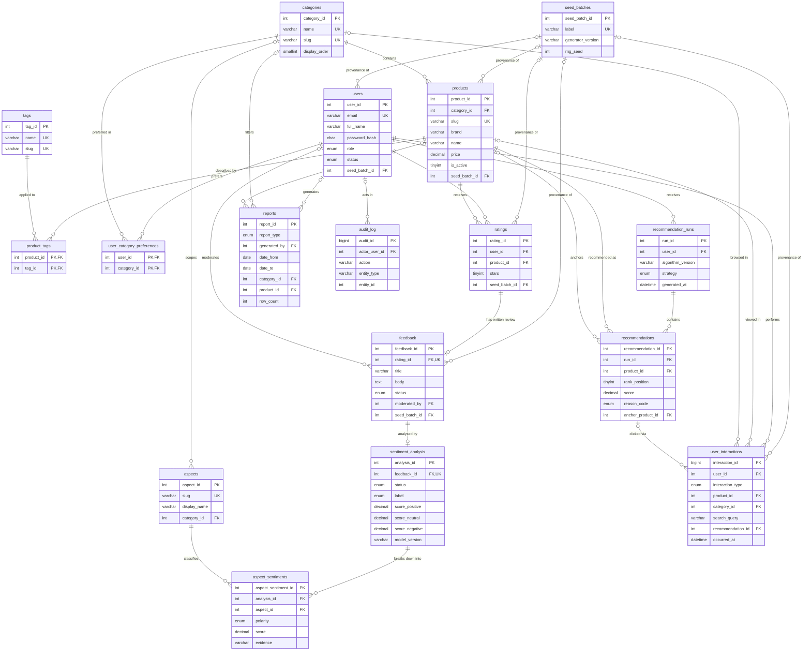

# 03 — Database Design: `feedback_ai_db`

Status: **design, awaiting approval.** The executable DDL (`database/01_schema.sql`) is written in Phase 3 and must match this document exactly. Table and column names come from `docs/00_DECISIONS.md` §4, which is binding.

Engine and conventions:
- MySQL 8.0.46, InnoDB, `utf8mb4` / `utf8mb4_0900_ai_ci`, so `email` uniqueness is case-insensitive automatically.
- Surrogate keys are `INT UNSIGNED AUTO_INCREMENT`; `user_interactions` and `audit_log` use `BIGINT UNSIGNED`.
- FK columns use the same type and signedness as the key they reference.
- Timestamps are `DATETIME`, written in UTC. The mysql2 pool uses `timezone: 'Z'` and each connection sets `time_zone = '+00:00'`.
- Surrogate keys never change, so **every FK is `ON UPDATE RESTRICT`**. This is also required for FK columns that appear in CHECK constraints (§7).
- `lower_case_table_names=2` is set on this server, so every identifier is lowercase snake_case.

---

## 1. Design goals and business rules

**Goals**
1. One source of truth: MySQL holds every application fact. Nothing is stored in localStorage or a cache.
2. Store facts, derive figures. Averages, counts, percentages, confidence and MIXED sentiment are computed with SQL (views, procedures) and never stored.
3. The database enforces integrity (FK, UNIQUE, CHECK, triggers), not only the API.
4. Customer text and AI output live in separate tables, so analysis can be re-run, can fail, or can be missing without touching the original feedback.
5. Every demo row is traceable to a seed batch, and genuine submissions are distinguishable from demo data.

**Business rules**

| ID | Rule | Enforced by |
|---|---|---|
| BR-1 | A user has at most one rating per product. Re-rating updates the existing row. | `UNIQUE(user_id, product_id)` on `ratings` and the upsert in `sp_submit_review` |
| BR-2 | A written review always belongs to exactly one rating. A rating has at most one review, so there is at most one review per user per product. | `feedback.rating_id NOT NULL UNIQUE` FK |
| BR-3 | The review body is 10–4000 characters. The title is optional (at most 120). | CHECK and zod validation in the API |
| BR-4 | Only ACTIVE users may rate. Only active products (`is_active = 1`) may be rated or reviewed. | `trg_ratings_before_insert`, `trg_ratings_before_update` |
| BR-5 | Every review has exactly one `sentiment_analysis` row, created as PENDING. Editing the body resets it to PENDING and removes stale aspect rows. | `UNIQUE(feedback_id)`, `trg_feedback_after_insert`, `trg_feedback_after_update` |
| BR-6 | Analysis never overwrites the original text. A COMPLETED analysis must have a label, scores and `analyzed_at`. | Separate table and CHECK `chk_sa_completed` |
| BR-7 | An analysis has at most one sentiment per aspect. | `UNIQUE(analysis_id, aspect_id)` |
| BR-8 | Overall MIXED is a derived fact: the analysis has at least one POSITIVE and at least one NEGATIVE aspect. | `v_feedback_details.is_mixed` (not stored) |
| BR-9 | A category that still has products cannot be deleted. | `products.category_id` RESTRICT |
| BR-10 | A product with any ratings or interactions cannot be deleted. It is archived (`is_active = 0`) instead. | `ratings.product_id` and `user_interactions.product_id` RESTRICT |
| BR-11 | Deleting a user removes that user's ratings, reviews, analyses, interactions, preferences and recommendations. | ON DELETE CASCADE chain |
| BR-12 | The system always keeps at least one ACTIVE admin. | `trg_users_before_delete`, `trg_users_before_update` |
| BR-13 | Demo rows carry `seed_batch_id`, and NULL means a genuine submission. There is no "verified purchase" concept anywhere in the schema. | Nullable FK to `seed_batches` |
| BR-14 | Each interaction type has a fixed shape. Product views and recommendation clicks need a product. Category views need a category. Searches need a query. | CHECK `chk_ui_shape` |
| BR-15 | Recommendations are stored as runs. Within a run, each product and each rank appears once, and every item carries a reason. | `UNIQUE(run_id, product_id)`, `UNIQUE(run_id, rank_position)`, `reason_text NOT NULL` |
| BR-16 | Reports store parameters and metadata only, and `date_from ≤ date_to`. | CHECK `chk_reports_dates` |
| BR-17 | Every change to a feedback item's moderation status is audited. | `trg_feedback_after_update` writes `audit_log` |
| BR-18 | Public pages show only PUBLISHED feedback. A star rating still counts toward the product average when its text is hidden, because the rating and the text are separate facts. | View and API filters (policy, see §11) |

---

## 2. ER diagram



**Reading the cardinalities**
- `ratings ||--o| feedback`: a rating has zero or one review, and a review has exactly one rating.
- `feedback ||--o| sentiment_analysis`: zero or one structurally. The insert trigger guarantees that one exists after every commit.
- `products |o--o{ user_interactions`: `product_id` is NULL for searches and category views.
- `seed_batches |o--o{ …`: a row belongs to zero or one seed batch, and zero means a genuine submission.

**Many-to-many relationships resolved with junction tables**
- products ↔ tags through `product_tags`
- users ↔ categories (preferences) through `user_category_preferences`
- users ↔ products (ratings) through `ratings`, an associative entity with its own attribute `stars`

---

## 3. Relational schema

Notation: `PK` is the primary key, `UK` a unique (candidate) key, and `→ table` a foreign key.

```
seed_batches(seed_batch_id PK, label UK, generator_version, rng_seed, description, created_at)

users(user_id PK, full_name, email UK, password_hash, role, status,
      seed_batch_id → seed_batches, last_login_at, created_at, updated_at)

categories(category_id PK, name UK, slug UK, description, display_order, created_at, updated_at)

products(product_id PK, category_id → categories, name, slug UK, brand, description, price,
         image_url, is_active, seed_batch_id → seed_batches, created_at, updated_at)
         UK(brand, name)

tags(tag_id PK, name UK, slug UK)

product_tags(product_id → products, tag_id → tags)                      PK(product_id, tag_id)

user_category_preferences(user_id → users, category_id → categories, created_at)
                                                                          PK(user_id, category_id)

ratings(rating_id PK, user_id → users, product_id → products, stars,
        seed_batch_id → seed_batches, created_at, updated_at)            UK(user_id, product_id)

feedback(feedback_id PK, rating_id → ratings UK, title, body, status,
         moderated_by → users, moderated_at, moderation_note,
         seed_batch_id → seed_batches, created_at, updated_at)

sentiment_analysis(analysis_id PK, feedback_id → feedback UK, status, label,
                   score_positive, score_neutral, score_negative, detected_language,
                   model_name, model_version, text_sha256, was_truncated, attempt_count,
                   last_error, analyzed_at, created_at, updated_at)

aspects(aspect_id PK, slug UK, display_name, category_id → categories)

aspect_sentiments(aspect_sentiment_id PK, analysis_id → sentiment_analysis,
                  aspect_id → aspects, polarity, score, evidence)        UK(analysis_id, aspect_id)

user_interactions(interaction_id PK, user_id → users, interaction_type,
                  product_id → products, category_id → categories, search_query,
                  recommendation_id → recommendations, seed_batch_id → seed_batches, occurred_at)

recommendation_runs(run_id PK, user_id → users, algorithm_version, strategy, generated_at)

recommendations(recommendation_id PK, run_id → recommendation_runs, product_id → products,
                rank_position, score, reason_code, reason_text,
                anchor_product_id → products, dismissed_at)
                UK(run_id, product_id), UK(run_id, rank_position)

reports(report_id PK, report_type, generated_by → users, date_from, date_to,
        category_id → categories, product_id → products, sentiment_filter, row_count, created_at)

audit_log(audit_id PK, actor_user_id → users, action, entity_type, entity_id, details, created_at)
```

---

## 4. Data dictionary

Column legend: **N** means nullable (Y/N). **Key** is PK, UK, FK or IDX. Every `created_at` defaults to `CURRENT_TIMESTAMP`. Every `updated_at` defaults to `CURRENT_TIMESTAMP ON UPDATE CURRENT_TIMESTAMP`.

### 4.1 `seed_batches`: provenance of generated demo data
| Column | Type | N | Key | Default | Constraint | Description |
|---|---|---|---|---|---|---|
| seed_batch_id | INT UNSIGNED | N | PK | auto | | Surrogate key |
| label | VARCHAR(60) | N | UK | | | Batch name, e.g. `demo-v1`. The seeder checks it for idempotency. |
| generator_version | VARCHAR(20) | N | | | | Version of the generator script |
| rng_seed | INT | N | | | | Fixed RNG seed, so the batch can be reproduced |
| description | VARCHAR(255) | Y | | NULL | | Free-text note |
| created_at | DATETIME | N | | now | | When the batch was inserted |

### 4.2 `users`
| Column | Type | N | Key | Default | Constraint | Description |
|---|---|---|---|---|---|---|
| user_id | INT UNSIGNED | N | PK | auto | | Surrogate key |
| full_name | VARCHAR(100) | N | | | | Display name |
| email | VARCHAR(150) | N | UK | | CHECK `email LIKE '%_@_%._%'` | Login identifier. The collation makes it case-insensitive. |
| password_hash | CHAR(60) | N | | | | bcrypt hash (cost 12). Plaintext is never stored. |
| role | ENUM('CUSTOMER','ADMIN') | N | | 'CUSTOMER' | | Authorization role |
| status | ENUM('ACTIVE','SUSPENDED') | N | | 'ACTIVE' | | Suspended users cannot log in or rate |
| seed_batch_id | INT UNSIGNED | Y | FK | NULL | → seed_batches RESTRICT | NULL means a genuine registration |
| last_login_at | DATETIME | Y | | NULL | | Last successful login |
| created_at / updated_at | DATETIME | N | | now | | Audit timestamps |

### 4.3 `categories`
| Column | Type | N | Key | Default | Constraint | Description |
|---|---|---|---|---|---|---|
| category_id | INT UNSIGNED | N | PK | auto | | Surrogate key |
| name | VARCHAR(60) | N | UK | | | e.g. "Home Appliances" |
| slug | VARCHAR(70) | N | UK | | CHECK `slug REGEXP '^[a-z0-9-]+$'` | URL key for `/categories/:slug` |
| description | VARCHAR(255) | Y | | NULL | | Short blurb |
| display_order | SMALLINT | N | | 0 | | Navigation ordering |
| created_at / updated_at | DATETIME | N | | now | | |

### 4.4 `products`
| Column | Type | N | Key | Default | Constraint | Description |
|---|---|---|---|---|---|---|
| product_id | INT UNSIGNED | N | PK | auto | | Surrogate key |
| category_id | INT UNSIGNED | N | FK, IDX | | → categories RESTRICT | Owning category |
| name | VARCHAR(150) | N | UK(brand,name) | | | Product name |
| slug | VARCHAR(170) | N | UK | | | URL key |
| brand | VARCHAR(80) | N | UK(brand,name) | | | Manufacturer or brand |
| description | TEXT | N | FULLTEXT | | | Long description, searchable |
| price | DECIMAL(10,2) | N | | | CHECK `price > 0` | Current list price |
| image_url | VARCHAR(255) | Y | | NULL | | Relative path or URL |
| is_active | TINYINT(1) | N | IDX | 1 | | 0 means archived: hidden from customers and not rateable |
| seed_batch_id | INT UNSIGNED | Y | FK | NULL | → seed_batches RESTRICT | Provenance |
| created_at / updated_at | DATETIME | N | | now | | |

### 4.5 `tags`: product attributes used for content similarity
| Column | Type | N | Key | Default | Constraint | Description |
|---|---|---|---|---|---|---|
| tag_id | INT UNSIGNED | N | PK | auto | | Surrogate key |
| name | VARCHAR(40) | N | UK | | | e.g. "Noise cancelling" |
| slug | VARCHAR(50) | N | UK | | | e.g. `noise-cancelling` |

### 4.6 `product_tags`
| Column | Type | N | Key | Default | Constraint | Description |
|---|---|---|---|---|---|---|
| product_id | INT UNSIGNED | N | PK, FK | | → products CASCADE | Tagged product |
| tag_id | INT UNSIGNED | N | PK, FK, IDX | | → tags CASCADE | Applied tag |

### 4.7 `user_category_preferences`
| Column | Type | N | Key | Default | Constraint | Description |
|---|---|---|---|---|---|---|
| user_id | INT UNSIGNED | N | PK, FK | | → users CASCADE | User |
| category_id | INT UNSIGNED | N | PK, FK | | → categories CASCADE | A category the user explicitly prefers |
| created_at | DATETIME | N | | now | | When the user picked it |

### 4.8 `ratings`
| Column | Type | N | Key | Default | Constraint | Description |
|---|---|---|---|---|---|---|
| rating_id | INT UNSIGNED | N | PK | auto | | Surrogate key |
| user_id | INT UNSIGNED | N | UK(user_id,product_id), FK | | → users CASCADE | Rater |
| product_id | INT UNSIGNED | N | UK(user_id,product_id), FK, IDX | | → products RESTRICT | Rated product |
| stars | TINYINT UNSIGNED | N | IDX | | CHECK `stars BETWEEN 1 AND 5` | Star rating |
| seed_batch_id | INT UNSIGNED | Y | FK | NULL | → seed_batches RESTRICT | Provenance |
| created_at / updated_at | DATETIME | N | | now | | `updated_at` changes when the user re-rates |

### 4.9 `feedback`: written reviews (original text, never modified by AI)
| Column | Type | N | Key | Default | Constraint | Description |
|---|---|---|---|---|---|---|
| feedback_id | INT UNSIGNED | N | PK | auto | | Surrogate key |
| rating_id | INT UNSIGNED | N | UK, FK | | → ratings CASCADE | The rating this text explains. The user and product come from it. |
| title | VARCHAR(120) | Y | | NULL | | Optional headline |
| body | TEXT | N | | | CHECK `CHAR_LENGTH(body) BETWEEN 10 AND 4000` | Review text exactly as submitted |
| status | ENUM('PUBLISHED','HIDDEN','FLAGGED') | N | IDX(status,created_at) | 'PUBLISHED' | | Moderation state |
| moderated_by | INT UNSIGNED | Y | FK | NULL | → users SET NULL | Admin who last moderated |
| moderated_at | DATETIME | Y | | NULL | | Time of last moderation |
| moderation_note | VARCHAR(255) | Y | | NULL | | Reason shown in the admin UI |
| seed_batch_id | INT UNSIGNED | Y | FK | NULL | → seed_batches RESTRICT | Provenance |
| created_at / updated_at | DATETIME | N | IDX(created_at) | now | | `created_at` drives the feedback-volume trends |

### 4.10 `sentiment_analysis`: AI output, one row per feedback
| Column | Type | N | Key | Default | Constraint | Description |
|---|---|---|---|---|---|---|
| analysis_id | INT UNSIGNED | N | PK | auto | | Surrogate key |
| feedback_id | INT UNSIGNED | N | UK, FK | | → feedback CASCADE | Analysed review |
| status | ENUM('PENDING','PROCESSING','COMPLETED','FAILED','UNSUPPORTED') | N | IDX | 'PENDING' | | Pipeline state |
| label | ENUM('POSITIVE','NEUTRAL','NEGATIVE') | Y | IDX | NULL | `chk_sa_completed` | Model label after the neutral-threshold policy |
| score_positive | DECIMAL(5,4) | Y | | NULL | CHECK 0–1 | Model probability |
| score_neutral | DECIMAL(5,4) | Y | | NULL | CHECK 0–1 | Model probability |
| score_negative | DECIMAL(5,4) | Y | | NULL | CHECK 0–1 | Model probability |
| detected_language | VARCHAR(10) | Y | | NULL | | ISO code from langdetect |
| model_name | VARCHAR(120) | Y | | NULL | | e.g. `cardiffnlp/twitter-roberta-base-sentiment-latest` |
| model_version | VARCHAR(40) | Y | | NULL | | Release and label-policy tag |
| text_sha256 | CHAR(64) | Y | | NULL | | Hash of the text **as analysed**, used to detect stale or duplicate analysis |
| was_truncated | TINYINT(1) | N | | 0 | | 1 if the input exceeded 512 tokens |
| attempt_count | TINYINT UNSIGNED | N | | 0 | | Retry counter. The worker stops at 5. |
| last_error | VARCHAR(255) | Y | | NULL | | Last failure reason (timeout, invalid response, …) |
| analyzed_at | DATETIME | Y | | NULL | `chk_sa_completed` | Completion time |
| created_at / updated_at | DATETIME | N | | now | | `updated_at` is used to reclaim stuck PROCESSING rows |

### 4.11 `aspects`: lookup of aspect categories (mirrors `ai-service/lexicon/aspects.json`)
| Column | Type | N | Key | Default | Constraint | Description |
|---|---|---|---|---|---|---|
| aspect_id | INT UNSIGNED | N | PK | auto | | Surrogate key |
| slug | VARCHAR(40) | N | UK | | | e.g. `battery-life`. Matches the AI response. |
| display_name | VARCHAR(60) | N | | | | e.g. "Battery life" |
| category_id | INT UNSIGNED | Y | FK | NULL | → categories RESTRICT | NULL means a general aspect (delivery, price/value, …) |

### 4.12 `aspect_sentiments`
| Column | Type | N | Key | Default | Constraint | Description |
|---|---|---|---|---|---|---|
| aspect_sentiment_id | INT UNSIGNED | N | PK | auto | | Surrogate key |
| analysis_id | INT UNSIGNED | N | UK(analysis_id,aspect_id), FK | | → sentiment_analysis CASCADE | Parent analysis |
| aspect_id | INT UNSIGNED | N | UK, FK, IDX(aspect_id,polarity) | | → aspects RESTRICT | Aspect mentioned |
| polarity | ENUM('POSITIVE','NEUTRAL','NEGATIVE') | N | IDX | | | Clause-level sentiment |
| score | DECIMAL(5,4) | N | | | CHECK 0–1 | Probability of the stated polarity |
| evidence | VARCHAR(300) | N | | | | The clause that produced this aspect |

### 4.13 `user_interactions`: behavioural signals (ratings and reviews are **not** copied here)
| Column | Type | N | Key | Default | Constraint | Description |
|---|---|---|---|---|---|---|
| interaction_id | BIGINT UNSIGNED | N | PK | auto | | Surrogate key |
| user_id | INT UNSIGNED | N | FK, IDX(user_id,occurred_at) | | → users CASCADE | Actor |
| interaction_type | ENUM('PRODUCT_VIEW','CATEGORY_VIEW','SEARCH','RECOMMENDATION_CLICK') | N | IDX | | `chk_ui_shape` | Kind of event |
| product_id | INT UNSIGNED | Y | FK, IDX(product_id,interaction_type,occurred_at) | NULL | → products RESTRICT; `chk_ui_shape` | Viewed or clicked product |
| category_id | INT UNSIGNED | Y | FK | NULL | → categories RESTRICT; `chk_ui_shape` | Browsed category |
| search_query | VARCHAR(120) | Y | | NULL | `chk_ui_shape` | Normalised search text |
| recommendation_id | INT UNSIGNED | Y | FK | NULL | → recommendations SET NULL | The recommendation that was clicked |
| seed_batch_id | INT UNSIGNED | Y | FK | NULL | → seed_batches RESTRICT | Provenance |
| occurred_at | DATETIME | N | | | | Event time. Seed data back-dates it. |

### 4.14 `recommendation_runs`
| Column | Type | N | Key | Default | Constraint | Description |
|---|---|---|---|---|---|---|
| run_id | INT UNSIGNED | N | PK | auto | | Surrogate key |
| user_id | INT UNSIGNED | N | FK, IDX(user_id,generated_at) | | → users CASCADE | Recipient |
| algorithm_version | VARCHAR(20) | N | | | | e.g. `cb-1.0` |
| strategy | ENUM('PERSONALIZED','COLD_START') | N | | | | Which path produced the run |
| generated_at | DATETIME | N | | | | Generation time |

### 4.15 `recommendations`
| Column | Type | N | Key | Default | Constraint | Description |
|---|---|---|---|---|---|---|
| recommendation_id | INT UNSIGNED | N | PK | auto | | Surrogate key |
| run_id | INT UNSIGNED | N | UK×2, FK | | → recommendation_runs CASCADE | Parent run |
| product_id | INT UNSIGNED | N | UK(run_id,product_id), FK | | → products CASCADE | Recommended product |
| rank_position | TINYINT UNSIGNED | N | UK(run_id,rank_position) | | CHECK 1–50 | Display order |
| score | DECIMAL(6,4) | N | | | | Final weighted score |
| reason_code | ENUM('SIMILAR_TO_RATED','PREFERRED_CATEGORY','SIMILAR_TO_VIEWED','SEARCH_MATCH','TOP_RATED_FALLBACK','POPULAR_FALLBACK') | N | | | | Dominant scoring term |
| reason_text | VARCHAR(255) | N | | | | Human-readable explanation |
| anchor_product_id | INT UNSIGNED | Y | FK | NULL | → products SET NULL | The product in "Because you rated X" |
| dismissed_at | DATETIME | Y | | NULL | | Set when the user clicks "Not interested" |

### 4.16 `reports`: report requests (parameters only)
| Column | Type | N | Key | Default | Constraint | Description |
|---|---|---|---|---|---|---|
| report_id | INT UNSIGNED | N | PK | auto | | Surrogate key |
| report_type | ENUM('SENTIMENT_SUMMARY','PRODUCT_PERFORMANCE','CATEGORY_SATISFACTION','ASPECT_INSIGHTS','FEEDBACK_EXPORT') | N | | | | Report template |
| generated_by | INT UNSIGNED | Y | FK | NULL | → users SET NULL | Admin who ran it |
| date_from | DATE | Y | | NULL | `chk_reports_dates` | Filter start |
| date_to | DATE | Y | | NULL | `chk_reports_dates` | Filter end |
| category_id | INT UNSIGNED | Y | FK | NULL | → categories SET NULL | Category filter |
| product_id | INT UNSIGNED | Y | FK | NULL | → products SET NULL | Product filter |
| sentiment_filter | ENUM('POSITIVE','NEUTRAL','NEGATIVE','MIXED') | Y | | NULL | | Sentiment filter |
| row_count | INT UNSIGNED | N | | | | Rows produced at generation time |
| created_at | DATETIME | N | | now | | Generation time |

### 4.17 `audit_log`
| Column | Type | N | Key | Default | Constraint | Description |
|---|---|---|---|---|---|---|
| audit_id | BIGINT UNSIGNED | N | PK | auto | | Surrogate key |
| actor_user_id | INT UNSIGNED | Y | FK | NULL | → users SET NULL | Acting admin. Set from `@app_actor_id`. |
| action | VARCHAR(40) | N | | | | e.g. `FEEDBACK_STATUS_CHANGED`, `USER_SUSPENDED`, `PRODUCT_ARCHIVED` |
| entity_type | VARCHAR(30) | N | | | | e.g. `feedback`, `user`, `product` |
| entity_id | INT UNSIGNED | N | | | | Affected row id. Deliberately **no FK**, so the log survives deletion of the row. |
| details | VARCHAR(255) | Y | | NULL | | e.g. `PUBLISHED→HIDDEN` |
| created_at | DATETIME | N | | now | | Event time |

---

## 5. Foreign key matrix

ON UPDATE is **RESTRICT** for every FK, because surrogate keys are immutable.

| # | Child.column | → Parent | ON DELETE | Why |
|---|---|---|---|---|
| 1 | users.seed_batch_id | seed_batches | RESTRICT | Provenance cannot be erased while demo rows exist |
| 2 | products.seed_batch_id | seed_batches | RESTRICT | Same |
| 3 | ratings.seed_batch_id | seed_batches | RESTRICT | Same |
| 4 | feedback.seed_batch_id | seed_batches | RESTRICT | Same |
| 5 | user_interactions.seed_batch_id | seed_batches | RESTRICT | Same |
| 6 | products.category_id | categories | RESTRICT | BR-9: products are never orphaned or silently deleted with their category |
| 7 | product_tags.product_id | products | CASCADE | Tag links have no meaning without the product |
| 8 | product_tags.tag_id | tags | CASCADE | Removing a tag removes its links |
| 9 | user_category_preferences.user_id | users | CASCADE | Personal data goes with the user |
| 10 | user_category_preferences.category_id | categories | CASCADE | A preference for a removed category is meaningless |
| 11 | ratings.user_id | users | CASCADE | BR-11 |
| 12 | ratings.product_id | products | RESTRICT | BR-10: rated products are archived, not deleted, so history is preserved |
| 13 | feedback.rating_id | ratings | CASCADE | A review cannot exist without its rating (BR-2) |
| 14 | feedback.moderated_by | users | SET NULL | The moderation outcome stays when the admin account is removed |
| 15 | sentiment_analysis.feedback_id | feedback | CASCADE | Analysis is subordinate to its text |
| 16 | aspect_sentiments.analysis_id | sentiment_analysis | CASCADE | Subordinate to the analysis |
| 17 | aspect_sentiments.aspect_id | aspects | RESTRICT | A lexicon aspect that is in use cannot be dropped |
| 18 | aspects.category_id | categories | RESTRICT | Keeps the lexicon consistent |
| 19 | user_interactions.user_id | users | CASCADE | BR-11 |
| 20 | user_interactions.product_id | products | RESTRICT | BR-10. RESTRICT is also **required**, because the column is used in `chk_ui_shape` (§7). |
| 21 | user_interactions.category_id | categories | RESTRICT | Same reason, and it is already implied by #6 |
| 22 | user_interactions.recommendation_id | recommendations | SET NULL | The click remains as a product signal after run history is pruned |
| 23 | recommendation_runs.user_id | users | CASCADE | BR-11 |
| 24 | recommendations.run_id | recommendation_runs | CASCADE | Items belong to their run |
| 25 | recommendations.product_id | products | CASCADE | Only reachable for products with no ratings or interactions (BR-10). Losing old suggestions is harmless. |
| 26 | recommendations.anchor_product_id | products | SET NULL | The explanation degrades gracefully |
| 27 | reports.generated_by | users | SET NULL | Report metadata outlives the admin account |
| 28 | reports.category_id | categories | SET NULL | The filter reference is optional |
| 29 | reports.product_id | products | SET NULL | Same |
| 30 | audit_log.actor_user_id | users | SET NULL | The audit trail must survive account deletion |

**Cascade chain when a user is deleted:**
- users → ratings → feedback → sentiment_analysis → aspect_sentiments
- users → user_interactions, user_category_preferences
- users → recommendation_runs → recommendations, which sets `user_interactions.recommendation_id` to NULL on any surviving rows

**Rows that block deletion with a 1451 error, mapped to HTTP 409 by the API:**
- deleting a category that has products
- deleting a product that has ratings or interactions
- deleting a seed batch while its rows exist
- deleting an aspect that is in use

> MySQL does **not** fire triggers for rows changed by FK cascades. So deleting a user does not run `trg_feedback_*` for that user's reviews. This is intended: the content is gone, and the API writes one `USER_DELETED` audit row before the delete.

---

## 6. Normalization

### 6.1 First normal form

Every attribute is atomic and every table has a primary key.

Repeating groups are moved into junction tables:
- tags would otherwise be stored as `"wireless,budget"` in products; they go in `product_tags`
- preferred categories go in `user_category_preferences`
- aspect results go in `aspect_sentiments`, not a JSON column on the analysis
- recommended products go in `recommendations`, not a list on the run

`reports` deliberately stores no result payload. A JSON blob of rows would be a non-atomic, stale copy of derivable data.

### 6.2 Functional dependencies (key tables)

| Relation | Candidate keys | Non-trivial FDs |
|---|---|---|
| users | {user_id}, {email} | user_id → all. email → all. |
| categories | {category_id}, {name}, {slug} | each key → all |
| products | {product_id}, {slug}, {brand, name} | each key → all. There is **no** product_id → category_name: the name lives in `categories`. |
| ratings | {rating_id}, {user_id, product_id} | each key → stars, seed_batch_id, timestamps |
| feedback | {feedback_id}, {rating_id} | each key → title, body, status, moderation columns |
| sentiment_analysis | {analysis_id}, {feedback_id} | each key → status, label, scores, model columns, … |
| aspect_sentiments | {aspect_sentiment_id}, {analysis_id, aspect_id} | each key → polarity, score, evidence |
| recommendations | {recommendation_id}, {run_id, product_id}, {run_id, rank_position} | each key → score, reason_code, reason_text, anchor_product_id, dismissed_at |
| recommendation_runs | {run_id} | run_id → user_id, algorithm_version, strategy, generated_at |
| product_tags, user_category_preferences | the whole composite PK | all-key (only `created_at` depends on the full key) |

### 6.3 Second normal form

No non-key attribute depends on part of a composite candidate key.

- **`recommendation_runs` is separate from `recommendations`.** If `algorithm_version`, `strategy` and `generated_at` were stored on every item row, then in `recommendations(run_id, product_id, …)` the FD `run_id → generated_at` would be a **partial dependency** on the candidate key `{run_id, product_id}`. That is a 2NF violation, with the update anomaly of rewriting the run timestamp on every item. Splitting the run header from its items removes it.
- In `ratings`, `stars` needs both `user_id` and `product_id`, so there is no partial dependency.
- In `aspect_sentiments`, `polarity` depends on both the analysis and the aspect. The aspect's `display_name` lives in `aspects`.

### 6.4 Third normal form (and BCNF)

No non-key attribute depends on another non-key attribute. In every table above, the determinant of each FD is a candidate key, so every relation is in **BCNF**. The one documented exception is in §6.5.

**Specific decisions:**

1. **Categories and tags are extracted from InventoryOS's free-text `products.category`.**
   - InventoryOS repeats the category name in every product row.
   - Renaming "Headphones" means updating many rows (update anomaly). A typo silently creates a new category (insertion anomaly). A category cannot exist without a product (insertion anomaly). Deleting the last product loses the category (deletion anomaly).
   - `categories(category_id, name, slug, …)` with an FK removes all four anomalies. Tags follow the same reasoning, with an M:N relationship.
2. **`feedback` references `rating_id` instead of repeating `user_id` and `product_id`.**
   - Adding `user_id` and `product_id` would not technically break 3NF *inside* `feedback`, because `rating_id` is a candidate key there.
   - It would, however, create **cross-table redundancy**: `feedback.user_id` could disagree with `ratings.user_id` for the same `rating_id`, unless an extra composite FK enforced it.
   - Storing the fact once, in `ratings`, makes that inconsistency impossible and enforces BR-2 for free. The user and product of a review are always obtained through `JOIN ratings`.
3. **Confidence is derived, not stored.**
   - The model returns three probabilities, and the label policy picks the label. "Confidence" is the probability of the chosen label.
   - Storing it would add the FD `{label, score_positive, score_neutral, score_negative} → confidence`. That is a non-key attribute determined by other non-key attributes, a **transitive dependency** and a 3NF violation, and the two could drift apart.
   - `v_feedback_details` computes it with `CASE label WHEN 'POSITIVE' THEN score_positive …`.
4. **The average rating is derived, not stored.**
   - `products.avg_rating` would be a copy of `AVG(ratings.stars)` that every insert, update or cascade-delete of a rating must keep in sync. That invites race conditions under concurrent ratings and stale values when cascades skip triggers.
   - `v_product_rating_stats` computes count, average, Bayesian average and the star distribution. The `ratings(product_id, stars)` index keeps this fast at our scale.
5. **MIXED overall sentiment is derived.** It is a function of the rows in `aspect_sentiments`: at least one POSITIVE and at least one NEGATIVE. Storing it on `sentiment_analysis` would duplicate facts from another relation, and it would go stale whenever aspects are recomputed.
6. **`reports` stores only parameters.**
   - A stored result set would be derived data, frozen at one moment, often large, and not atomic.
   - Re-running the parameterised SQL reproduces it. `row_count` is kept as an immutable snapshot fact ("this run returned N rows"), not as a cache.
7. **`text_sha256` is not redundant with `feedback.body`.** It is the hash of the text *as it was analysed*, a historical fact about the analysis. Comparing it with the hash of the current body shows whether the analysis is stale.
8. **Activity history is a view, not a table.** `v_user_activity` UNIONs `user_interactions`, `ratings` and `feedback`. Copying ratings and reviews into `user_interactions` would store every fact twice.

### 6.5 Documented, controlled redundancy

- **`user_interactions.recommendation_id → product_id`** holds for RECOMMENDATION_CLICK rows. This is a transitive dependency.
  - It is kept on purpose. `recommendation_id` is SET NULL when run history is pruned, and the click must still count as a product signal for the recommender.
  - The API always copies `product_id` from the recommendation row when it inserts a click, so the two cannot disagree on insert.
- **`user_interactions` combines four event subtypes in one table**, with nullable columns and a shape CHECK. The alternative, one table per subtype (`product_views`, `searches`, …), is fully normalised but makes the timeline UNION and the recency weighting clumsier.
  - Product views and recommendation clicks must leave `category_id` NULL, because the category is derivable through the product. That keeps the merged table free of category redundancy.
- **`audit_log.entity_type` + `entity_id`** is a polymorphic reference with no FK. This is deliberate: an audit trail must outlive the rows it describes.

---

## 7. Constraints catalogue

**Primary keys:** one surrogate PK per table, except the composite PKs of the two junction tables (`product_tags`, `user_category_preferences`).

**UNIQUE (candidate keys)**
| Table | Constraint | Columns |
|---|---|---|
| seed_batches | uq_seed_batches_label | label |
| users | uq_users_email | email |
| categories | uq_categories_name, uq_categories_slug | name; slug |
| products | uq_products_slug, uq_products_brand_name | slug; (brand, name) |
| tags | uq_tags_name, uq_tags_slug | name; slug |
| ratings | uq_ratings_user_product | (user_id, product_id) |
| feedback | uq_feedback_rating | rating_id |
| sentiment_analysis | uq_sa_feedback | feedback_id |
| aspects | uq_aspects_slug | slug |
| aspect_sentiments | uq_as_analysis_aspect | (analysis_id, aspect_id) |
| recommendations | uq_rec_run_product, uq_rec_run_rank | (run_id, product_id); (run_id, rank_position) |

**CHECK**
| Table | Constraint | Expression |
|---|---|---|
| users | chk_users_email | `email LIKE '%_@_%._%'` |
| categories | chk_categories_slug | `slug REGEXP '^[a-z0-9-]+$'` |
| products | chk_products_price | `price > 0` |
| ratings | chk_ratings_stars | `stars BETWEEN 1 AND 5` |
| feedback | chk_feedback_body_len | `CHAR_LENGTH(body) BETWEEN 10 AND 4000` |
| sentiment_analysis | chk_sa_score_pos / _neu / _neg | `score_x IS NULL OR score_x BETWEEN 0 AND 1` |
| sentiment_analysis | chk_sa_completed | `status <> 'COMPLETED' OR (label IS NOT NULL AND score_positive IS NOT NULL AND analyzed_at IS NOT NULL)` |
| aspect_sentiments | chk_as_score | `score BETWEEN 0 AND 1` |
| user_interactions | chk_ui_shape | `(interaction_type IN ('PRODUCT_VIEW','RECOMMENDATION_CLICK') AND product_id IS NOT NULL AND category_id IS NULL AND search_query IS NULL) OR (interaction_type = 'CATEGORY_VIEW' AND category_id IS NOT NULL AND product_id IS NULL AND search_query IS NULL) OR (interaction_type = 'SEARCH' AND search_query IS NOT NULL AND product_id IS NULL AND category_id IS NULL)` |
| recommendations | chk_rec_rank | `rank_position BETWEEN 1 AND 50` |
| reports | chk_reports_dates | `date_from IS NULL OR date_to IS NULL OR date_from <= date_to` |

**NOT NULL:** every column marked N = "N" in §4. Nullable columns are only those whose absence has a meaning: optional text, pending AI output, provenance, optional filters, and moderation fields.

**ENUMs** restrict categorical domains: role, status, labels, interaction types, reason codes and report types. Under `STRICT_TRANS_TABLES`, an invalid value is an error, not a silent empty string.

**MySQL 8 gotcha (error 3823, `ER_CHECK_CONSTRAINT_CLAUSE_USING_FK_REFER_ACTION_COLUMN`)**
- A column used in a CHECK constraint cannot also be the column of an FK with a referential action (CASCADE, SET NULL or SET DEFAULT), on either ON DELETE or ON UPDATE.
- Consequences in this schema:
  - `user_interactions.product_id` and `category_id` use **RESTRICT** for both actions, which allows `chk_ui_shape`.
  - `user_interactions.recommendation_id` (SET NULL) is deliberately **not** referenced by the CHECK. "Only clicks carry a recommendation_id" is enforced in the API.
  - `feedback.moderated_by` (SET NULL) has no CHECK pairing it with `moderated_at`.
- Phase 3 must verify this by running the DDL, not assume it.

**Trigger-enforced rules** (definitions in `04_DBMS_OBJECTS_AND_QUERIES.md`):
- BR-4: active user and active product
- BR-5: an analysis row always exists and is reset on edit
- BR-12: last admin
- BR-17: moderation audit

`INSERT … ON DUPLICATE KEY UPDATE` fires `BEFORE INSERT`, then `BEFORE UPDATE` / `AFTER UPDATE` on a duplicate. That is why ratings need both the insert and the update trigger.

---

## 8. Index plan

InnoDB automatically creates an index on any FK column that has no usable leading index. Every FK is therefore indexed, even when not listed.

| Table | Index | Serves |
|---|---|---|
| users | uq_users_email | Login: `WHERE email = ?` |
| categories | uq_categories_slug | Category page: `WHERE slug = ?` |
| products | uq_products_slug | Product page: `WHERE slug = ?` |
| products | idx_products_category_active (category_id, is_active) | Explore and category listing: `WHERE category_id = ? AND is_active = 1` |
| products | ft_products_search FULLTEXT(name, brand, description) | Search: `MATCH(...) AGAINST(? IN NATURAL LANGUAGE MODE)`, and the recommender's search_match term |
| product_tags | PK(product_id, tag_id) | Tags of one product (similarity vector) |
| product_tags | idx_product_tags_tag (tag_id) | Products sharing a tag (candidate generation) |
| ratings | uq_ratings_user_product | Duplicate prevention. Its leftmost column serves "my ratings" (`WHERE user_id = ?`). |
| ratings | idx_ratings_product_stars (product_id, stars) | `AVG(stars)` and star distribution `GROUP BY product_id`, covering the scan for `v_product_rating_stats` |
| feedback | uq_feedback_rating | `JOIN feedback ON feedback.rating_id = ratings.rating_id` |
| feedback | idx_feedback_status_created (status, created_at) | Moderation queue and public lists: `WHERE status = 'PUBLISHED' ORDER BY created_at DESC` |
| feedback | idx_feedback_created (created_at) | Date-range filters and the monthly trend `GROUP BY DATE_FORMAT(created_at,'%Y-%m')` |
| sentiment_analysis | uq_sa_feedback | Join from feedback |
| sentiment_analysis | idx_sa_status (status) | Worker queue: `WHERE status IN ('PENDING','FAILED') AND attempt_count < 5` |
| sentiment_analysis | idx_sa_label (label) | Sentiment distribution counts |
| aspect_sentiments | uq_as_analysis_aspect | Aspects of one review |
| aspect_sentiments | idx_as_aspect_polarity (aspect_id, polarity) | "Top complaints / most praised features": `GROUP BY aspect_id, polarity` |
| user_interactions | idx_ui_user_time (user_id, occurred_at) | Activity history and recency-weighted profile: `WHERE user_id = ? ORDER BY occurred_at DESC` |
| user_interactions | idx_ui_product_type_time (product_id, interaction_type, occurred_at) | Product popularity (views in the last 90 days), product performance |
| recommendation_runs | idx_rr_user_time (user_id, generated_at) | Latest run per user, last-3-runs anti-repetition check |
| recommendations | uq_rec_run_rank | Ordered list for a run: `WHERE run_id = ? ORDER BY rank_position` |

**Candidate indexes, to confirm with `EXPLAIN` in Phase 11** (not in `00_DECISIONS.md`):
- `audit_log(entity_type, entity_id)` for an entity's history
- `reports(created_at)` for the report history list

**FULLTEXT caveat:** `innodb_ft_min_token_size` defaults to 3, and the default stop-word list applies. So two-letter queries such as "TV" are not matched by MATCH…AGAINST. The search API falls back to `LIKE` for queries shorter than 3 characters.

---

## 9. Transactions, isolation and locking

The isolation level stays at InnoDB's default, **REPEATABLE READ**. Every multi-statement write below runs on one pooled connection, between `BEGIN` and `COMMIT`/`ROLLBACK`, inside try/finally so the connection is always released.

| # | Operation | Statements inside one transaction | Notes |
|---|---|---|---|
| T1 | Submit or edit a review (`sp_submit_review`) | 1. Validate user and product with `SELECT … FOR SHARE`. 2. Upsert the rating. 3. Upsert the feedback on `rating_id`. 4. The trigger creates or resets the `sentiment_analysis` row. | **The AI call happens after COMMIT**, never inside the transaction, so locks are not held for up to 8 seconds |
| T2 | Claim analysis work (worker) | `SELECT analysis_id … WHERE status IN ('PENDING','FAILED') AND attempt_count < 5 ORDER BY updated_at LIMIT 20 FOR UPDATE SKIP LOCKED`, then `UPDATE … SET status='PROCESSING', attempt_count = attempt_count + 1` | `SKIP LOCKED` (MySQL 8) lets concurrent workers take disjoint batches. Rows stuck in PROCESSING with `updated_at` older than 5 minutes are reclaimed. |
| T3 | Store an analysis result | `UPDATE sentiment_analysis SET status='COMPLETED', label=…, scores…, text_sha256=…, analyzed_at=NOW() WHERE analysis_id=? AND status='PROCESSING'`. If one row is affected: `DELETE FROM aspect_sentiments WHERE analysis_id=?`, then a multi-row `INSERT` of aspects. | If the user edited the review meanwhile, the trigger has already reset the status to PENDING. The guarded UPDATE then affects 0 rows and the stale result is discarded. |
| T4 | Generate recommendations | `INSERT recommendation_runs`, then a multi-row `INSERT recommendations` | Scoring reads happen before the write transaction. Only the writes are transactional, so a run is never half-stored. |
| T5 | Moderate feedback | `SET @app_actor_id = ?`, then `UPDATE feedback SET status, moderated_by, moderated_at, moderation_note` | The trigger writes `audit_log` in the same transaction |
| T6 | Delete a user | Insert the `USER_DELETED` audit row, then `DELETE FROM users` | The last-admin trigger can SIGNAL and roll back both statements |
| T7 | Seed a batch | Insert the `seed_batches` row, then all upserts | All or nothing, so a re-run never leaves a partial batch |
| T8 | Dashboard KPIs | `START TRANSACTION READ ONLY WITH CONSISTENT SNAPSHOT`, then the KPI SELECTs, then COMMIT | All cards come from the same snapshot, so totals and percentages agree with each other |

**Rating upsert race (double-click, two tabs, retried request).** Two concurrent "SELECT, and INSERT if missing" sequences could both see no row and insert duplicates. The design removes the race in the database itself:

```sql
INSERT INTO ratings (user_id, product_id, stars)
VALUES (?, ?, ?) AS new
ON DUPLICATE KEY UPDATE
  stars     = new.stars,
  rating_id = LAST_INSERT_ID(ratings.rating_id);   -- returns the existing id on update
SELECT LAST_INSERT_ID() INTO v_rating_id;
```

- `UNIQUE(user_id, product_id)` makes the INSERT and the conflict check atomic. The second request becomes an UPDATE of the same row, so the outcome is idempotent.
- The row-alias syntax (`AS new`) replaces the `VALUES()` function, which is deprecated since 8.0.20.
- Under REPEATABLE READ, ON DUPLICATE KEY UPDATE takes next-key locks on the unique index. Rare deadlocks (1213) or lock-wait timeouts (1205) are possible under contention, so the API **retries the whole transaction up to 3 times**.
- Auto-increment gaps from failed or duplicate inserts are expected and harmless.
- `feedback` is upserted the same way on `UNIQUE(rating_id)`. On a duplicate, `trg_feedback_after_update` resets the analysis.

---

## 10. Representative DDL excerpts

These three tables show the constraint style. The full script is a Phase 3 deliverable.

```sql
CREATE TABLE users (
  user_id        INT UNSIGNED  NOT NULL AUTO_INCREMENT,
  full_name      VARCHAR(100)  NOT NULL,
  email          VARCHAR(150)  NOT NULL,
  password_hash  CHAR(60)      NOT NULL,
  role           ENUM('CUSTOMER','ADMIN')   NOT NULL DEFAULT 'CUSTOMER',
  status         ENUM('ACTIVE','SUSPENDED') NOT NULL DEFAULT 'ACTIVE',
  seed_batch_id  INT UNSIGNED  NULL,
  last_login_at  DATETIME      NULL,
  created_at     DATETIME      NOT NULL DEFAULT CURRENT_TIMESTAMP,
  updated_at     DATETIME      NOT NULL DEFAULT CURRENT_TIMESTAMP ON UPDATE CURRENT_TIMESTAMP,
  CONSTRAINT pk_users           PRIMARY KEY (user_id),
  CONSTRAINT uq_users_email     UNIQUE (email),
  CONSTRAINT chk_users_email    CHECK (email LIKE '%_@_%._%'),
  CONSTRAINT fk_users_seed      FOREIGN KEY (seed_batch_id) REFERENCES seed_batches (seed_batch_id)
                                ON DELETE RESTRICT ON UPDATE RESTRICT
) ENGINE=InnoDB DEFAULT CHARSET=utf8mb4 COLLATE=utf8mb4_0900_ai_ci;

CREATE TABLE ratings (
  rating_id      INT UNSIGNED     NOT NULL AUTO_INCREMENT,
  user_id        INT UNSIGNED     NOT NULL,
  product_id     INT UNSIGNED     NOT NULL,
  stars          TINYINT UNSIGNED NOT NULL,
  seed_batch_id  INT UNSIGNED     NULL,
  created_at     DATETIME NOT NULL DEFAULT CURRENT_TIMESTAMP,
  updated_at     DATETIME NOT NULL DEFAULT CURRENT_TIMESTAMP ON UPDATE CURRENT_TIMESTAMP,
  CONSTRAINT pk_ratings              PRIMARY KEY (rating_id),
  CONSTRAINT uq_ratings_user_product UNIQUE (user_id, product_id),
  CONSTRAINT chk_ratings_stars       CHECK (stars BETWEEN 1 AND 5),
  INDEX idx_ratings_product_stars (product_id, stars),
  CONSTRAINT fk_ratings_user    FOREIGN KEY (user_id)       REFERENCES users (user_id)
                                ON DELETE CASCADE  ON UPDATE RESTRICT,
  CONSTRAINT fk_ratings_product FOREIGN KEY (product_id)    REFERENCES products (product_id)
                                ON DELETE RESTRICT ON UPDATE RESTRICT,
  CONSTRAINT fk_ratings_seed    FOREIGN KEY (seed_batch_id) REFERENCES seed_batches (seed_batch_id)
                                ON DELETE RESTRICT ON UPDATE RESTRICT
) ENGINE=InnoDB DEFAULT CHARSET=utf8mb4 COLLATE=utf8mb4_0900_ai_ci;

CREATE TABLE sentiment_analysis (
  analysis_id        INT UNSIGNED NOT NULL AUTO_INCREMENT,
  feedback_id        INT UNSIGNED NOT NULL,
  status             ENUM('PENDING','PROCESSING','COMPLETED','FAILED','UNSUPPORTED') NOT NULL DEFAULT 'PENDING',
  label              ENUM('POSITIVE','NEUTRAL','NEGATIVE') NULL,
  score_positive     DECIMAL(5,4) NULL,
  score_neutral      DECIMAL(5,4) NULL,
  score_negative     DECIMAL(5,4) NULL,
  detected_language  VARCHAR(10)  NULL,
  model_name         VARCHAR(120) NULL,
  model_version      VARCHAR(40)  NULL,
  text_sha256        CHAR(64)     NULL,
  was_truncated      TINYINT(1)   NOT NULL DEFAULT 0,
  attempt_count      TINYINT UNSIGNED NOT NULL DEFAULT 0,
  last_error         VARCHAR(255) NULL,
  analyzed_at        DATETIME     NULL,
  created_at         DATETIME NOT NULL DEFAULT CURRENT_TIMESTAMP,
  updated_at         DATETIME NOT NULL DEFAULT CURRENT_TIMESTAMP ON UPDATE CURRENT_TIMESTAMP,
  CONSTRAINT pk_sentiment_analysis PRIMARY KEY (analysis_id),
  CONSTRAINT uq_sa_feedback        UNIQUE (feedback_id),
  CONSTRAINT chk_sa_score_pos CHECK (score_positive IS NULL OR score_positive BETWEEN 0 AND 1),
  CONSTRAINT chk_sa_score_neu CHECK (score_neutral  IS NULL OR score_neutral  BETWEEN 0 AND 1),
  CONSTRAINT chk_sa_score_neg CHECK (score_negative IS NULL OR score_negative BETWEEN 0 AND 1),
  CONSTRAINT chk_sa_completed CHECK (status <> 'COMPLETED'
                                     OR (label IS NOT NULL AND score_positive IS NOT NULL AND analyzed_at IS NOT NULL)),
  INDEX idx_sa_status (status),
  INDEX idx_sa_label  (label),
  CONSTRAINT fk_sa_feedback FOREIGN KEY (feedback_id) REFERENCES feedback (feedback_id)
                            ON DELETE CASCADE ON UPDATE RESTRICT
) ENGINE=InnoDB DEFAULT CHARSET=utf8mb4 COLLATE=utf8mb4_0900_ai_ci;
```

**Table creation order** (parents before children):
1. seed_batches
2. users
3. categories
4. tags
5. products
6. product_tags
7. user_category_preferences
8. aspects
9. ratings
10. feedback
11. sentiment_analysis
12. aspect_sentiments
13. recommendation_runs
14. recommendations
15. user_interactions
16. reports
17. audit_log

The DDL script uses `CREATE TABLE IF NOT EXISTS` and never runs `DROP DATABASE`. Rebuilding from scratch is a separate, explicitly named `database/99_reset_dev.sql` that only targets `feedback_ai_db`.

---

## 11. Open questions (for approval)

1. **Do hidden reviews' ratings still count in averages (BR-18)?** The current proposal is yes, because hiding moderates the text, not the score. The alternative is to exclude ratings whose feedback is HIDDEN from `v_product_rating_stats`.
2. **Should the three scores be required to sum to about 1?** Optional extra CHECK: `score_positive + score_neutral + score_negative BETWEEN 0.995 AND 1.005` when they are not NULL. It is not in `00_DECISIONS.md` yet.
3. **Is a model registry table needed?** `model_name` and `model_version` are stored as a pair. If `model_version` were ever unique per model, `model_version → model_name` would be a transitive dependency. In that case, add an `ai_models` lookup table instead of the two columns. This is not needed while only one model is used.
