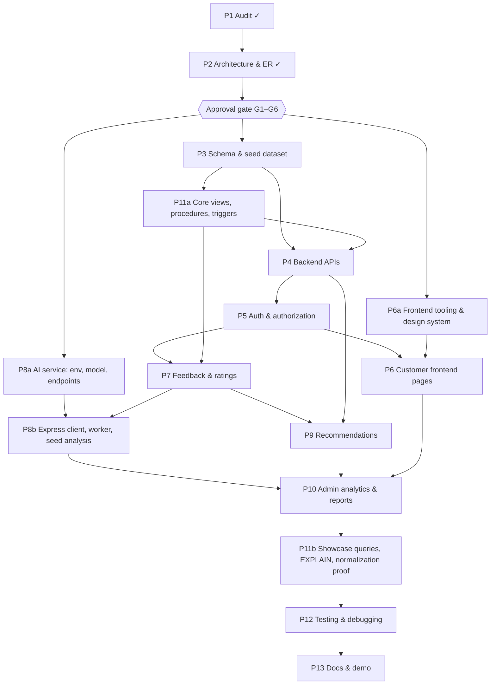

# 07 — Phased Implementation Plan

**Status:** proposed, awaiting approval. **Date:** 2026-10-31.

**Binding decisions:** [00_DECISIONS.md](00_DECISIONS.md). **Task tracker:** [../PROJECT_TODO.md](../PROJECT_TODO.md). Task IDs below (P3-T02 style) refer to the tracker.

**Ground rules for every phase:**
- Inspect before modifying.
- Back up `.env` before touching it.
- Never touch `inventory_warehouse_db` or `~/Desktop/InventoryOS`.
- Test after each phase.
- Update `PROJECT_TODO.md` the moment a task's status changes.
- Never mark a test as passed unless it was executed. Record its output in `docs/TEST_REPORT.md`.

---

## 1. Approval gates (needed from you before Phase 3)

| Gate | Decision | Options | Default proposal | Blocks |
|---|---|---|---|---|
| **G1** | Baseline git tag | Create the tag `inventoryos-baseline` on `e92f6ed` / skip | Create it. Cheap, and it makes the InventoryOS code recoverable inside this repo. | P1-T11, P4-T01 |
| **G2** | Workspace clutter | Delete / move to `_archive/` / keep. Items: the copied `mysql_data/` (197 MB stale copy of a live datadir), `Archive.zip` (30 MB, contains a `.env`), `mysql.log`, `mysql.sock.lock`, `backend/.env.backup`, root `package-lock.json` stub, `DBMS PRESENTATION.pdf` | Delete `mysql_data/`, `mysql.log` and `mysql.sock.lock`. Keep `Archive.zip` and the PDF until you confirm. Delete `.env.backup` after taking a new backup. | P1-T12 |
| **G3** | Database placement | **A:** existing MySQL 8.0.46 on 3307 with a new `feedback_ai_db` and dedicated accounts. Simple, and matches the brief. The DB files physically live under `InventoryOS/mysql_data/`, and two accounts are added to the shared server. **B:** a freshly initialised mysqld on 3308 with its datadir inside FeedbackAI. Fully isolated, but a second server to start. | **A** | P3-T01 |
| **G4** | Python for the AI service | Install Python **3.11 or 3.12** from python.org or Homebrew. The system 3.9.6 is not supported by current torch/transformers wheels. | python.org installer (no Homebrew needed) | P8-T01 |
| **G5** | Product brands in seed data | Fictional brands with realistic specs / real brands and model names | **Fictional.** This avoids implying real customer opinions about real products. | P3-T05 |
| **G6** | Retire InventoryOS code in this workspace | Remove the inventory, order and warehouse controllers, routes and UI in Phase 4 / keep them alongside | **Remove.** The original folder and the G1 tag preserve them, and dead code confuses the demo. | P4-T01 |

Nothing in Phase 3 or later starts until you approve the planning docs and answer G1–G6 (P2-T11).

---

## 2. Execution order and dependency graph

The phase numbers follow the brief, but the **execution order differs in one place**. The core DBMS objects from Phase 11 (views, procedures, triggers) are built straight after the schema, because review submission, analysis and analytics all depend on them. Phase 11's showcase and EXPLAIN work runs late.

**Critical path:** G, then P3, P11a, P4, P5, P7, P8b, P10, P11b, P12, P13.

## 3. What can run in parallel

| Lane | Work | Can start after | Why it is independent |
|---|---|---|---|
| A: Database | P3 schema, P11a objects, seeder | G | Owns `database/**` and `backend/scripts/**` only. |
| B: AI service | P8-T01…T07, T13 (Python service, model, aspects, pytest) | G and G4 | Separate process, separate folder (`ai-service/**`). Needs only the lexicon from P3-T06. |
| C: Review corpus | P3-T05…T07 (catalog, lexicon, about 200 hand-written reviews) | G and G5 | Pure content files under `database/seed/`. The longest single content task. |
| D: Frontend foundation | P6-T01…T03 (Tailwind, tokens, UI components) | G | No API dependency. Built against component fixtures. |
| E: Backend | P4, P5, P7, P9, P10 APIs | Lane A schema | Sequential within the lane. They share `backend/src/**`. |

Lanes A–D can run concurrently. Lane E joins A once the schema exists. The frontend pages (P6-T04 onward) join E once auth exists. **Only one writer per folder at a time.**

---

## 4. Phase-by-phase plan

### Phase 1 — Existing project audit ✓

| | |
|---|---|
| **Goal** | Understand InventoryOS before changing anything. |
| **Deliverables** | `docs/00_DECISIONS.md` §1, `docs/01_TECHNICAL_ASSESSMENT.md` |
| **Exit gate** | Every brief §2 inspection item is answered, and debt, bugs and security issues are listed with fixes. |
| **Tests** | Read-only checks: MySQL `SHOW DATABASES` and datadir, port scan, toolchain versions. |
| **Remaining** | P1-T11 tag (G1), P1-T12 clutter (G2). |

### Phase 2 — Architecture and ER diagram ✓ (pending approval)

| | |
|---|---|
| **Goal** | Freeze architecture, schema, AI contract and recommendation design on paper. |
| **Deliverables** | `docs/00`–`07`, `PROJECT_TODO.md` |
| **Exit gate** | User approval plus answers to G1–G6, recorded in `00_DECISIONS.md`. |
| **Tests** | The Mermaid ER renders. Table and column names agree across all docs. |

### Phase 3 — Database schema and seed dataset

| | |
|---|---|
| **Goal** | `feedback_ai_db` exists with 17 constrained tables and a realistic, idempotent demo dataset. |
| **Deliverables** | `database/00_create_database.sql`, `01_schema.sql`, `tests/constraint_tests.sql`, `tests/seed_checks.sql`, `seed/{catalog.json, corpus/*.json, generate.py, generated/demo-v1.json, README.md}`, `ai-service/lexicon/aspects.json`, `backend/scripts/{migrate.js, seed.js}` |
| **Steps** | 1. Baseline snapshot of `inventory_warehouse_db` (P3-T11). 2. Create the DB and accounts. 3. DDL. 4. Constraint tests. 5. Catalog and lexicon. 6. Corpus authoring. 7. Deterministic generator. 8. Seeder. 9. Realism checks. |
| **Exit gate** | Migrate and seed each run twice with no errors and identical counts. All negative constraint tests fail as expected. `inventory_warehouse_db` counts are unchanged. |
| **Tests** | P3-T04, P3-T10, P12-T14, P12-T15 (first run). |

### Phase 11a — Core DBMS objects (pulled forward)

| | |
|---|---|
| **Goal** | The views, procedures and triggers the app depends on. |
| **Deliverables** | `database/02_views.sql`, `03_procedures.sql`, `04_triggers.sql` (P11-T01…T03) |
| **Exit gate** | Every view runs under ONLY_FULL_GROUP_BY. Each procedure is called with valid and invalid arguments. Each trigger has a positive and a negative test. |
| **Tests** | Trigger tests in `constraint_tests.sql`. Spot checks of views against raw `AVG`/`COUNT`. |

### Phase 4 — Backend APIs

| | |
|---|---|
| **Goal** | A clean Express 4 API on port 5002 over `feedback_ai_db`, with InventoryOS code retired. |
| **Deliverables** | `app.js` / `server.js` split, env validation, DB layer with `withTransaction`, envelope and error handler (DB-error-to-HTTP mapping per 00 §5a.6), zod validation, pagination, and the categories, products, interactions, profile and admin users APIs, plus `docs/API.md`. |
| **Exit gate** | `GET /api/health` returns 200. Every list endpoint is paginated. No `error.message` leaks. Server refuses to boot with missing env. |
| **Tests** | `node:test` + supertest against `feedback_ai_test_db`: products, categories, pagination, error mapping. |

### Phase 5 — Authentication and authorization

| | |
|---|---|
| **Goal** | Secure customer and admin auth, with authorization enforced on the server. |
| **Deliverables** | Register, login, logout and `me`. bcrypt cost 12. JWT in an httpOnly SameSite=Strict cookie. Login rate limit. `requireAuth`, which re-reads status and role every request. `requireRole('ADMIN')`. Ownership enforcement. |
| **Exit gate** | Every `/api/admin/*` route returns 401 anonymously and 403 to a customer. An IDOR attempt fails. Suspension takes effect on the next request. |
| **Tests** | P5-T08 (auth suite), P12-T01…T03. |

### Phase 6 — Customer frontend

| | |
|---|---|
| **Goal** | All 12 customer pages on the editorial design system, wired to real APIs. |
| **Deliverables** | Tailwind 3.4 tokens, the UI component library, router, AuthContext, separate customer and admin layouts. Pages: landing, login, register, dashboard, explore, category, product detail, activity, profile. Feedback submission and my-feedback come in P7, recommendations in P9. |
| **Exit gate** | `npm run build` succeeds. Every page has loading, empty and error states. Deep links survive refresh. No horizontal scroll at 375 px. AA contrast is verified. |
| **Tests** | Visit every route in the browser with the console free of errors. Responsive check at 375, 768 and 1280 px. vitest for `lib/format.js` and the API error normaliser. |

### Phase 7 — Feedback and rating management

| | |
|---|---|
| **Goal** | Users rate and review exactly once per product (editable), and admins moderate. |
| **Deliverables** | Review API through `sp_submit_review`, double-submit protection, edit and delete, public reviews list, Feedback submission page, My feedback page, moderation API with audit log. |
| **Exit gate** | 5 parallel identical submissions leave 1 rating and 1 feedback row. An edit resets the analysis to PENDING. A HIDDEN review is never visible to customers. Averages come only from views. |
| **Tests** | P7-T10, P12-T06…T08. |

### Phase 8 — AI sentiment analysis

| | |
|---|---|
| **Goal** | A separate Python service for 3-class sentiment plus lexicon-based aspects, integrated so that the app works whether or not the AI is up. |
| **Deliverables** | `ai-service/` (FastAPI, model loaded once, label policy, language detection, aspect module, batch endpoint, token auth), Express `sentimentClient.js` and `analysisWorker.js`, `scripts/analyze-pending.js`, `scripts/evaluate.py`, `docs/AI_EVALUATION.md`. |
| **Steps** | P8a (lane B) can begin right after G4. P8b, the Express integration, waits for P7. |
| **Exit gate** | All seed reviews are analysed through the real pipeline. Stopping the AI service still allows review submission, and the backlog completes once the service is back. Evaluation metrics come from an actual run. |
| **Tests** | pytest suite (P8-T13), failure-handling integration (P8-T14), evaluation run (P8-T11). |

### Phase 9 — Personalised recommendations

| | |
|---|---|
| **Goal** | Explainable content-based recommendations, `cb-1.0`. |
| **Deliverables** | Profile features, scoring, exclusions and anti-repetition, diversity cap, explanations, cold start, persistence and lazy regeneration, API, Recommendations page and dashboard widget. |
| **Exit gate** | A new user receives 10 COLD_START results with reasons. A seed user's results exclude rated and dismissed products. Every item carries a reason. Nothing is called collaborative filtering. |
| **Tests** | P9-T10, P12-T11. A worked example is reproduced for the docs. |

### Phase 10 — Admin analytics and reports

| | |
|---|---|
| **Goal** | Filterable, SQL-backed admin insights and reports across all 8 admin pages. |
| **Deliverables** | Shared filter contract. KPI, top/bottom products, category satisfaction, product performance, monthly volume and aspect endpoints. Admin pages: dashboard, users, products, categories, feedback, sentiment, product performance, reports (with CSV export and metadata-only `reports` rows). |
| **Exit gate** | Every number on screen equals a direct SQL check (automated). Every chart is API-fed with a real empty state. Every table sorts, filters and paginates. |
| **Tests** | P10-T16, P12-T12, P12-T13. |

### Phase 11b — DBMS showcase and proofs

| | |
|---|---|
| **Goal** | Show each DBMS concept from the brief explicitly. |
| **Deliverables** | `database/queries/dbms_showcase.sql`, which includes the 7 required queries. EXPLAIN before and after indexes. Transaction inventory. Final normalization proof. |
| **Exit gate** | The showcase script runs end to end on the seeded DB. Outputs are captured. |
| **Tests** | Run the script and save its output to `docs/TEST_REPORT.md`. |

### Phase 12 — Testing and debugging

| | |
|---|---|
| **Goal** | Execute and record all 15 required test areas, end-to-end integration, security and the InventoryOS independence check. |
| **Deliverables** | `docs/TEST_REPORT.md` with real command output, and a bug log with regression tests. |
| **Exit gate** | No open P0 defects. InventoryOS row counts equal the baseline, and its app still starts on its own ports. |
| **Tests** | P12-T01…T22. |

### Phase 13 — Documentation and demonstration

| | |
|---|---|
| **Goal** | Anyone can set up and demo the project. The viva is prepared. |
| **Deliverables** | README, dev scripts, ER diagram PNG and SVG, final data dictionary, AI and recommendation docs, API reference, demo script, viva Q&A, screenshots, presentation outline. |
| **Exit gate** | A clean-checkout setup works by following the README. The demo has been rehearsed once end to end. |

---

## 5. Verification checklist (run after every phase)

1. **Build and boot.** Each service touched in the phase starts cleanly: frontend on 5174, Express on 5002, AI on 8001. `npm run build` passes for the frontend if it was touched.
2. **Tests executed.** The phase's test tasks were run, and the real output was pasted into `docs/TEST_REPORT.md`. No "should pass" claims.
3. **DB integrity.**
   - `database/tests/constraint_tests.sql` still behaves as expected.
   - No orphan rows: `feedback` without a rating, an `aspect_sentiments` row without its analysis.
   - Every feedback row has exactly one `sentiment_analysis` row.
4. **InventoryOS untouched.** `inventory_warehouse_db` table list and row counts equal the P3-T11 baseline. `~/Desktop/InventoryOS` has no new modifications (`git -C ~/Desktop/InventoryOS status`).
5. **Security spot check.**
   - No `.env` in `git ls-files`.
   - No error message leaks.
   - New routes carry the correct `requireAuth` / `requireRole`.
   - SQL is parameterized, and any dynamic ORDER BY is whitelisted.
6. **No fake data.** No hardcoded statistics, placeholder arrays or lorem ipsum in shipped pages.
7. **UI states.** Each new page has loading, empty, error and success states, labelled inputs, and works at 375 px.
8. **Tracker updated.** `PROJECT_TODO.md` statuses and the summary table reflect reality, with blockers named.
9. **Commit.** One commit per completed phase, after your OK, with the attribution trailer.

---

## 6. Rough effort estimates

These are focused working hours for one developer working with an assistant. The corpus authoring and the admin UI dominate.

| Phase | Estimate | Main cost driver |
|---|---:|---|
| 1 Audit | 3 h (done) | — |
| 2 Architecture and ER | 4 h (done) | — |
| 3 Schema and seed | 10–14 h | Hand-authoring about 200 realistic reviews (≈5 h) |
| 11a Core DB objects | 3–4 h | Trigger and procedure testing |
| 4 Backend APIs | 8–10 h | Products search, filters and pagination |
| 5 Auth | 5–6 h | Authorization test matrix |
| 6 Customer frontend | 14–18 h | Design system plus 9 pages |
| 7 Feedback and ratings | 6–8 h | Concurrency and idempotency tests |
| 8 AI service | 10–12 h | Model download and setup, aspect module, worker, evaluation |
| 9 Recommendations | 8–10 h | Scoring, explanations, tests |
| 10 Admin analytics | 14–18 h | 8 admin pages plus charts and consistency tests |
| 11b Showcase and proofs | 3–4 h | EXPLAIN analysis |
| 12 Testing | 8–10 h | End-to-end and security review |
| 13 Docs and demo | 5–6 h | Demo rehearsal, viva Q&A |
| **Total remaining** | **≈ 94–120 h** | |

**One-time environment costs:** the Python 3.11 install (G4). The model download (~500 MB, needs internet once, cached in `~/.cache/huggingface`). Roughly 1 GB of RAM while the AI service runs.

---

## 7. Known plan-level risks

The full list is in `06_RISKS_AND_BOTTLENECKS.md`.

- **Corpus quality vs time.** Hand-authored reviews are the slowest content task. Start lane C immediately after G5.
- **Model domain mismatch.** The model is trained on tweets. P8-T11 measures it, and the model can be swapped without schema changes because `model_name` and `model_version` are stored per analysis.
- **Phase ordering.** Building P11a early is deliberate. Leaving triggers for later would mean rewriting the review flow.
- **Shared MySQL server (Option A).** A mistake in a script could affect InventoryOS. This is mitigated by:
  - accounts whose grants are limited to `feedback_ai_db.*`;
  - DDL that never uses an unqualified `DROP`;
  - the baseline and after checks in every phase's verification.
